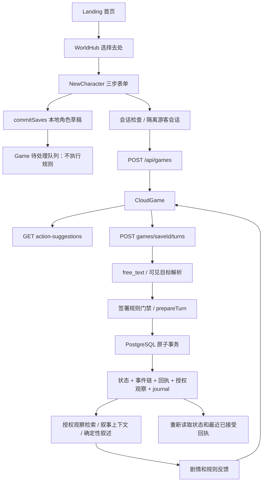

# P0 首次游玩与核心闭环审计

本轮范围：新建工作树 `D:/Nine-cloud-wt/p0-first-play-loop`，基于 `e3442c7cab7affc09dce1826fcb8a193b75f2b23`。只提交本地独立分支，不修改待审 PR，不开放生产回合。附件示意是体验参考，不是当前功能证据。

## 已核实的调用链

开发/preview-1 本地候选另有路径：NewCharacter → P2ReviewGame → 可见目标解析 → commitLocalAuthoritativeTurn → IndexedDB 事件链/回执/冻结授权观察 → 两种记忆模式的派生索引 → 显式只读记忆查询。该分支不是生产服务器回合。

## 功能矩阵

状态针对下述精确范围；存在代码不自动证明全产品完成。

| 功能 | 状态 | 当前调用与证据 / 限制 |
|---|---|---|
| 首页、选择去处、世界阅读 | IMPLEMENTED_CONNECTED | Landing → WorldHub → /new /world；浏览器 376/390/1366 交互验证。34 条 Canon 仅是内容运行数据，不等于完整玩法。 |
| 本地角色创建 | IMPLEMENTED_CONNECTED | 三步表单 → commitSaves/IndexedDB → Game；本地草稿保存恢复可触发。 |
| 角色表单驱动服务器人物 | IMPLEMENTED_DISCONNECTED | POST /api/games 只传 memoryMode；姓名、出身、修为、外貌没有映射进权威初始状态。 |
| 生产本地草稿的真实回合 | BLOCKED_BY_POLICY | Game.saveIntent 只加入 pendingQueue；不调用规则，不推进时间，不返回服务端剧情。 |
| 隔离服务器自由文本 | IMPLEMENTED_CONNECTED | CloudGame → games.ts → free_text → prepareTurn；真实 PostgreSQL 连续 10 个已接受回合。 |
| 行动建议 | IMPLEMENTED_CONNECTED | 状态派生 action-suggestions；填入后可编辑，不直接执行。服务器建议本轮默认展开。 |
| 服务器玩家页拾取/领奖入口 | IMPLEMENTED_DISCONNECTED | 规则 reducer 和内部结构化 /api/turns 可执行；CloudGame 仅走 free_text，p1-nlu-runtime/批准模板缺少 acquire_item、quest 文字入口。本地候选另有候选解析扩展，不等于服务器已集成。 |
| 规则合法性与失败关闭 | IMPLEMENTED_CONNECTED | 已签署 P1 review plugin；不支持文本保持 clarify/rejected，无状态/事件推进；不推断规则。 |
| 回合结算、事件与回执 | IMPLEMENTED_CONNECTED | PostgreSQL 状态、事件、回执、授权观察事务；既有集成覆盖并发、幂等、事务失败。 |
| 叙事 | PARTIAL | 确定性内容反馈可用；模型叙述可接收上下文，但本轮没有真实模型调用。默认确定性叙述不消费历史记忆。 |
| 短期/长期双记忆 | PARTIAL | 现行核心语义是授权观察 + continue/forgetting 两模式，不应称为完整 STM→LTM 自动巩固系统。没有证明长期记忆改变规则结果。 |
| 本地候选显式记忆查询 | IMPLEMENTED_CONNECTED | 冻结授权观察 → historical-event → 只读召回；T80 continue 能召回、forgetting 返回 forgotten；不是自动改变后续剧情。 |
| 服务器授权观察与记忆接口 | PARTIAL | 交谈产生 outbox；当前 P1 grant 未设置 memoryClass，落入 unclassified；严格历史召回不能把其推定为 historical-event。 |
| IndexedDB 存档与恢复 | IMPLEMENTED_CONNECTED | 本地候选 10 回合任务、刷新、回放、幂等、投影篡改拒绝；另有跨标签事务验收。 |
| PostgreSQL 存档与恢复 | PARTIAL | 权威状态/事件/回执持久化。本轮补读最近已接受回执并恢复结果；完整叙事文本/多回合阅读历史仍未持久化。 |
| 游客/登录用户所有权边界 | IMPLEMENTED_CONNECTED | 隔离游客建会话，无 OTP；服务端派生 actor、owner；他人不能读最近回执。 |
| 生产 Route A 实际封锁 | UNKNOWN | 本轮不访问生产、不改变上轮 Caddy 审计结论；代码中的授权不等于生产已开放。 |

## 第一次体验的实际流程

公开构建：首页“进入世界” → “新开一局” → 姓名（其他字段可空）→ 两次“下一步” → “保存角色并进入” → 本地角色草稿 → 输入行动 → “收入待处理”。仅写本机 IndexedDB；不需要登录，不产生服务器回合。这个流程不能计为“完成一次有效规则回合”。

隔离服务器：/new → 三步表单 → “创建服务端规则存档” → 自动创建隔离游客会话 → POST /api/games → CloudGame → 输入“观察渡船” → /turns → 第1回合；随后九次“对岑九说：不要去望气台”均由原签署规则接受，状态达到10；不支持的“打开时光裂缝”没有推进世界。此测试证明连续结算，不等于丰富的长篇剧情。

## 记忆证据及审批断点

`test-results/e2e/first-play-continuous-pg.json`：十个有效回合，九条交谈授权观察；记录逐回合反馈和 memory_class。观察行存在并未使确定性叙述变化。`test-results/first-play/local-gameplay.log`：本地候选首段任务到10回合，T80两个模式各80回合，continue 与 forgetting 在同一批授权事件上的只读召回不同。

本轮曾实现“只读取前一回合及以前授权观察，并在确定性叙述中显示同话题旧交谈提示”。完整单测触发 `P1_REVIEW_RULE_SEMANTIC_MISMATCH`（原签署94afe433…，候选edddd33…）；已撤回四个相关源文件，未重签、未改阈值、未绕过门禁。失败日志保留为 `unit-before-semantic-revert.log`。下一项审批应审阅：历史观察分类、前文裁剪边界、带来源的确定性记忆叙述，以及新语义哈希；批准前继续失败关闭。

## 实施的体验修复

1. 首页写清游戏类型、当前开放内容与服务器回合未开放，提供“了解玩法/探索世界”。
2. 建角提示“只填姓名即可”，说明本地角色草稿性质，保留既有字段和原规则。
3. 本地空剧情页明确保存成功和未开放范围，不把加入待处理队列写成行动执行。
4. CloudGame 默认展开建议，点击填入后聚焦输入框；增加自然语言占位提示。
5. CloudGame、P2ReviewGame 保留未提交草稿；服务器待确认请求保留原幂等键，刷新后仍需核对，不重新发起新行动；同步锁防重复点击。
6. PostgreSQL 最近已接受回执通过所有权过滤只读返回；刷新恢复结果并明确“原剧情文字暂未持久保存”。结果区域自动进入阅读位置。
7. 本地候选输入区移到世界简报后；技术完整性与记忆资料保留在后。
8. 长首页说明文案在日间动态场景暴露真实低对比度；已对该段新增专用不透明底色，未降低4.5:1门槛。失败日志 `e2e-before-home-contrast-fix.log` 保留。

## 自动化与证据口径

环境：Windows 10.0.26300，Node24.16.0，Edge157.0.4341.42，DPR1；本轮新增 PostgreSQL17 容器只绑定127.0.0.1:55433，数据库jiuxiao_test。没有连接生产数据库。Linux CI未执行。

精确候选SHA和命令退出码记录于 `test-results/first-play/final-verification.json`。各测试日志在同目录，正式回归八个脚本由 `pnpm test:e2e` 顺序执行。该日志尚未全部结束前不能写为全绿。首次诊断是在未提交候选上执行，应与最终候选分开。

移动设备截图为浏览器CSS视口模拟，不是华为浏览器或物理键盘证据；图为 `home/draft-376/390/1366-night/day.png`。既有 game-shell 与 cloud recovery 包括缩短视口、焦点、长文滚动和恢复，但不能替代真实虚拟键盘与后台恢复。

## 真人验收（按用户最新信息：本机电脑＋平板，手机不可用）

待执行，HUMAN_REQUIRED。设备数量与测试者人数分别记录；同一人第二台设备有学习效应，不能算独立陌生玩家。

| 设备 | 测试者及熟悉度 | 浏览器/CSS视口 | 理解游戏/找到入口 | 建角/找到输入 | 首次有效操作时间 | 错点/求助 | 结果理解/继续/恢复 | 原话 |
|---|---|---|---|---|---|---|---|---|
| 手机 | 暂不可用 | 未测试 | 未测试 | 未测试 | 未测试 | 未测试 | 未测试 | 未收集 |
| 平板 | 用户报告“已进行”；非独立陌生玩家证据 | HDC: BKY-W20 / OpenHarmony-7.0.0.111；浏览器名/CSS视口待提供；截图1840×2800为物理像素 | 4190首页已由只读截图确认加载；其余待记录 | 待记录 | 未提供 | 未提供 | 未提供 | 仅“已进行”，没有具体任务原话 |
| 电脑 | 待记录 | 待记录 | 待记录 | 待记录 | 待记录 | 待记录 | 待记录 | 待记录 |

主持人只给任务，不告知按钮位置。分别计时：公开模式3分钟内说明并完成当前开放的角色/草稿体验；隔离真实模式3分钟内完成第一个有效规则回合。记录中断后台后未提交文字、已保存状态、虚拟键盘遮挡和横竖屏。未提供的功能不能算成功。

## 四个问题的当前回答

1. 隔离环境可连续执行已签署首段规则：真实PG10有效回合，本地候选首段任务10回合；不代表任意自然语言或长篇开放世界已完整可玩。
2. 授权记忆会持久化和检索，本地两模式的召回有差异；没有证实完整短期→长期机制，也没有证实默认后续剧情自动受长期经历影响。此项未关闭。
3. 入口与文案已改善，但普通陌生玩家能否无说明上手仍为HUMAN_REQUIRED。
4. 还缺角色表单映射、经重新审阅签署的记忆叙述接入、完整剧情历史恢复与更丰富连续内容、真实设备/陌生玩家验收，以及独立的生产开放审批。

补充：服务器新存档的开场原文由既有已签署首段内容包读取，仅在版本、初始地点与修订0匹配时返回；不在前端编造开场。对应浏览器断言要求首回合前实际显示该段原文。

补充：真实API的376px截图发现开场被页脚和建议区挤掉。已缩小云端标题、在窄屏游戏页隐藏全站页脚、用弹性布局给剧情区保留至少120px，并对真实PG浏览器测试增加376/390/1366px剧情区域高度断言。这些都是CSS视口模拟，物理虚拟键盘仍需真人记录。

## 最终自动化结果

测试代码提交：`b2dad99bc27ca5e9e85f88b18f169bcfa5aa3646`。本报告后续仅记录验收证据，不把文档提交当成新的受测代码版本。

| 实际命令 | 退出码 | 数量与范围 |
|---|---|---|
| pnpm build | 0 | contracts/content/domain/db/api/web 与 Canon runtime check |
| pnpm typecheck | 0 | 工作区类型检查 |
| pnpm test | 0 | 同一隔离DB环境运行全部API测试：API375、web235、domain133、content25、contracts17；另有core/node断言，见原日志。与下列数据库门禁有重叠，不将数量相加当独立测试总数。 |
| pnpm test:integration | 0 | 11文件43测试，真实PostgreSQL |
| pnpm test:e2e | 0 | 八个正式脚本全部完成；20组五页面设计基线，4688文本运行、702边界采样，日/夜移动/桌面无对比度失败 |
| pnpm test:e2e:p2-local | 0 | 10回合首段任务、领奖、刷新到revision10；两种模式各80回合、只读召回差异、篡改与跨模式拒绝 |
| pnpm test:e2e:ui | 0 | 6视口/主题＋2无模糊回退，长剧情、缩短视口、焦点；待确认请求刷新后仍复用原键，1事件/2请求 |
| node tests/e2e/first-play-ux.cjs | 0 | 376/390/1366 × 日/夜共6组，真实本地草稿UI、刷新恢复、无横向溢出 |

精确命令、SHA、退出码和日志路径均见 `test-results/first-play/final-verification.json`；原始日志 `final-*.log`。Linux CI：NOT_RUN。自动化不代表真实用户理解能力。

真实PG浏览器追加证据：376px完成观察与九次交谈，10个已接受回合、10个规则事件、11个请求（其中1次不支持行动不推进状态）；九条授权观察仍为unclassified，后续重复交谈文字没有变化；390/1366px剧情高度断言≥120，刷新可恢复最近回执和未提交草稿。他人owner读最近回执返回null。

首段“完整清障任务”的额外证据来自正式 `p1-authenticated-candidate.cjs`：13请求、15事件、2个NPC授权观察，两个模式以不同路径完成；它使用内部结构化API，不能替代CloudGame自由文字页面的拾取/领奖入口验收。

本轮曾对较早中间版本运行完整门禁；因随后新增开场和发现剧情空间缺陷，中间运行被主动中止，日志保留，不计PASS。最终上表绑定b2dad99，退出码0，不复用中止运行。

平板操作边界：自动审批曾拒绝“打开浏览器＋抓屏”组合命令，仅返回blocked by policy。用户手动操作后，较小范围的只读截图允许执行；确认4190首页加载。没有自动点击、建角、输入或键盘/恢复成功证据。该截图为用户界面原始证据，保留在忽略目录，不打进产品或公开包。最终真人理解与物理键盘验收仍为HUMAN_REQUIRED。

总门禁：工程候选自动化PASS；本轮核心玩法闭环NOT_READY。未关闭项为：服务器自由文字拾取/领奖、人物表单映射、经签署的新记忆叙述接入、完整剧情历史持久化、电脑/平板具体真人记录，以及手机未测试。
