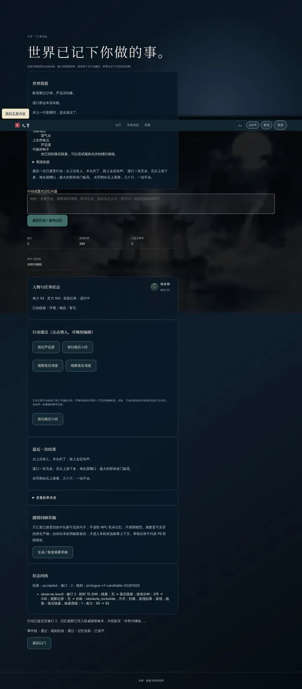
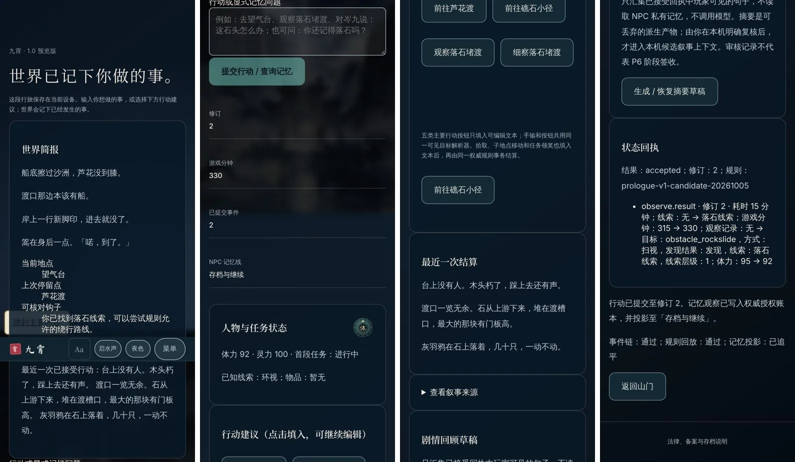

# 01 · 基线、全仓阅读账与线上实测

## 1. 版本基线（2026-11-25 核对）

| 项 | 值 | 证据 |
|---|---|---|
| `main` | `f1fe6ea` | `git ls-remote` |
| PR #119 | `9c0724f` | `refs/pull/119/head` |
| PR #120（方案 E） | `767ad5d` | `refs/pull/120/head`，堆叠在 #119 之上 |
| PR #121（VISION 02 任务书） | `4f1c314` | 分支 `docs/vision-02-art-direction`，堆叠在 #120 之上 |
| 本研究分支 | `docs/vision-02-claude-research` | 从 `4f1c314` 开出 |
| 正式站 | Cloudflare Pages 生产部署 `85adf881`，直传，源码 `c4c672f`；入口脚本 `index-CVXN4bqP.js` | Cloudflare API 只读查询；`/health` 返回 `saveSchemaVersion 3`，`/ready` 显示数据库正常 |
| Pages 的 Git 自动构建 | 自 11-09 起全部停在“排队”，生产一直靠手动直传更新 | 部署列表 |

## 2. 全仓阅读账

被跟踪的文件共 5156 个。按类别：

| 类别 | 规模 | 阅读方式 |
|---|---|---|
| `apps/api/src` | 146 个代码文件，30,485 行 | 两名子代理分区全文阅读，大型测试与仓储层略读，见[核心档案](appendix/dossier-api-core.md)、[AI 与酒馆档案](appendix/dossier-api-ai-cards.md) |
| `apps/web/src` | 150 个文件，20,752 行 | 子代理全文读了 52 个关键 TS/TSX 文件，约 25 个小文件与 44 个测试未读，CSS 只做清点，见[客户端档案](appendix/dossier-web-client.md)。我在 #120 中改过其中大部分页面，第三轮也亲自读过 |
| `packages/domain`、`contracts`、`content`、`db` | 约 9,800 行 | 规则、契约、内容与 schema 全文阅读，迁移略读，见[规则与内容档案](appendix/dossier-domain-content.md) |
| `functions`、`deployment`、CI、`scripts` | 约 5,400 行 | 全文阅读，见[运维与历史档案](appendix/dossier-ops-tests-legacy.md) |
| `tests/e2e`、`tests/integration` | 约 12,000 行 | 7 个关键 e2e 全读（含 1,670 行的 `foundation.cjs`），其余略读或只清点 |
| `tests/experiments` | 约 3,100 个文件，多为日志与压缩包 | 只清点 |
| `work/` 旧原型 | 7,367 行代码 + 资产 | 读了 `v1.js` 主体与构建脚本 |
| 世界书 | Canon 1.0 正式阅读版 982 行，34 条 | **我亲自逐行读完全文** |
| Markdown | 336 份 | 一名子代理分类，见 [08-制度修订候选](08-制度修订候选.md) |

“全文阅读”指子代理用读取工具逐文件打开，不是检索片段。每份档案开头都列了逐文件状态（全读、略读、未读）。档案不等于作者或我本人逐行审过全部 6.3 万行代码。下文的关键结论，我都对照过代码或线上表现。

## 3. 线上实测（三档设备）

方法：

- 浏览器：Playwright Chromium；
- 设备：桌面 1440×900、iPad Pro 11、iPhone 13；
- 流程：首页 → 进入世界 → 世界设定 → 建角三步 → 本机 1.0 预览玩法 → 提交一次移动建议、一次观察建议 → 存档 → AI 设置 → 画面设置 → 账号与云档 → 作品简介；
- 共截图 45 张。只在一次性的浏览器配置里写了本机存档，没有登录，也没有写服务器数据。

**现状游玩主屏**（2026-11-25，桌面与手机）：

## 4. 关键发现：为什么作者觉得“平庸”

1. **真正的游玩主屏是开发审阅面板。**
   - 玩家看到的是一列卡片：修订号、游戏分钟、已提交事件数、“状态回执 observe.result · 修订 2 · obstacle_rockslide”、规则版本 `prologue-v1-candidate-20261005`、事件链校验，还有“审核记录不代表 P6 阶段签收”这样的工程说明。
   - 预览构建只改了眉题和导语（`P2ReviewGame.tsx:355-359`）。方案 E 给这个页面换了皮肤，结构没动。
2. **输入和结果分在两处。** 提交行动后，结果出现在下方第六张卡片里。手机上要滚过约三屏才看得到。页面上也没有之前各回合的记录。
3. **世界不随游戏变化。**
   - 四个场景 ID 都对不上序章的三个地点，所有地点都回落到“山门”海报（`packages/content/src/scenes/manifest.ts:11-60`，`main.tsx:373, 948`）。
   - 游戏时刻、天色、事件都不驱动任何画面。
   - 画面设置页却写着“随地点切换”（`GraphicsSettings.tsx:54`）。
4. **叙述本身质量很高。** 例如“台上没有人。木头朽了，踩上去还有声。渡口一览无余。石从上游下来，堆在渡槽口，最大的那块有门板高。灰羽鸦在石上落着，几十只，一动不动。”句子短，景别清楚，带着声音和尺度，本身就像一份分镜表。问题出在呈现上，而不在内容。
5. **规则是确定性的，事件数据很细。** 每个事件都带精确的 `stateDelta`，例如体力 95→92、线索 无→落石线索、游戏分钟 315→330。这正是“画面由真实状态驱动”所需的数据，现在完全没被用上。

## 5. 新设计必须面对的真实约束

| 约束 | 说明 | 依据 |
|---|---|---|
| 可玩内容只有序章 | 3 个地点（芦花渡 → 望气台 → 折桂坪），NPC 只有岑九，战斗目标只有灰羽鸦，2 件物品，5 条线索，1 个任务；时间从 05:00（卯初）开始，17:00 入暮（酉初），1 刻 = 15 分钟 | 规则档案 §2 |
| 很多系统还没有 | 突破、地图、天气、势力、经济、灵根都没有实现 | 规则档案 §6 |
| 境界顺序与 Canon 冲突 | 运行代码的 `REALM_ORDER` 把化神排在合体前，Canon 正文是合体在前，并写明“合体期大圆满”才能化神。要设计突破，必须先由作者裁定 | 规则档案 §7 |
| 叙述的时机 | 规则提交之后，在同一个请求里生成叙述，不流式，生产环境不保存叙述，重试会重新生成 | AI 档案 §2 |
| 可见性 | 完整的 facts 会泄露剧透，需要一个按可见性过滤的视图接口 | 核心档案 §9 |
| 云端游戏找不回 | 大厅和“最近”只列本机存档，没有链接就回不到云端游戏 | 客户端档案 §10 |
| 3D 被 CI 挡住 | `artifact-scan.mjs:9` 禁止 three.js 进入网页构建；媒体授权闸门不检查 `.glb`、`.ktx2` 等 3D 格式 | 运维档案 §4 |
| 问卷（8 人，样本很小） | 75% 用手机玩；62.5% 最想要“把我的话变成行动”；界面偏好“立绘 + 场景插图 + 可折叠状态栏”占 50%，纯文字聊天 0% | 运维档案 §9 |

## 6. 顺带发现的真实问题（不在本阶段修）

每条都附代码位置，详见各档案。

- 线上“人物与任务状态”的已知线索显示为“环视”，同一回合的回执写的却是“落石线索”。疑似把观察方式当成了线索名。走查中两档设备都复现了。
- 非 UUID 的 `clarificationOf` 会得到 503，而不是 4xx。
- 先建一个游客会话就能绕过 Turnstile，进而耗尽每小时 600 封的全局邮件额度。
- 事件链校验每回合都把全部事件走一遍，开销随局数平方增长；P2 本机运行时也有同样的问题。
- 避水符的效果标记从来没被读取，持有它并不提供任何保护。
- 4 条已签 Canon 条目的公开正文里混进了编辑批注，其中一条带有“【待归属】”。
- 每次导航都从 localStorage 镜像重新载入存档，镜像写失败时会显示旧数据，并误报冲突。
- 群聊默认模式下，系统提示要求“只返回故事文本”，后附的契约却要求 JSON，接入真实模型时很可能报错。
- CI 在规则包不匹配、API 拒绝启动时仍可能显示绿色（`p1-authenticated-candidate.cjs:116-132`）。
