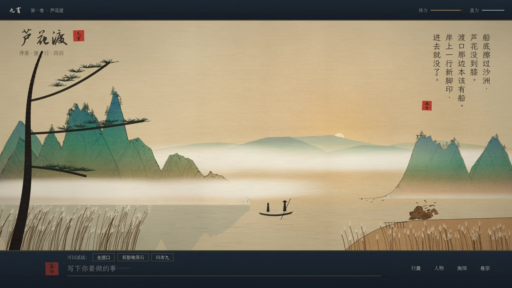
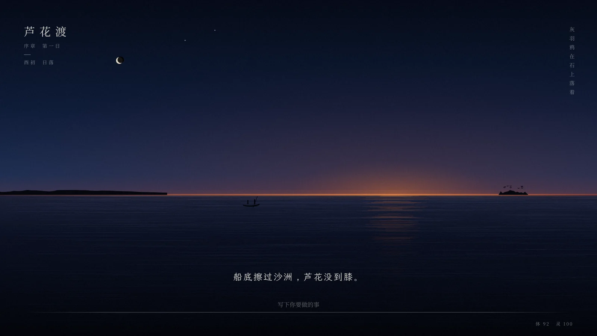
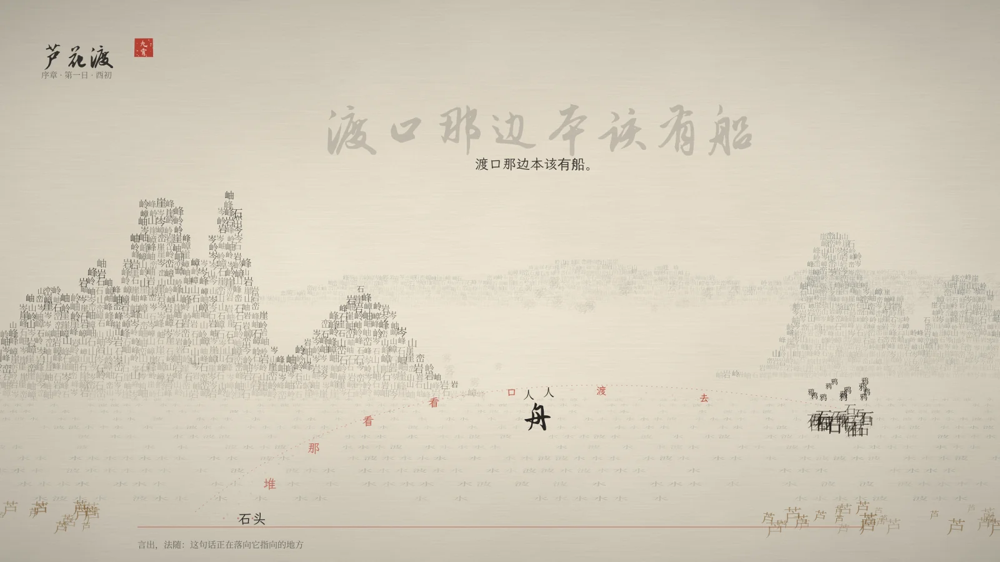
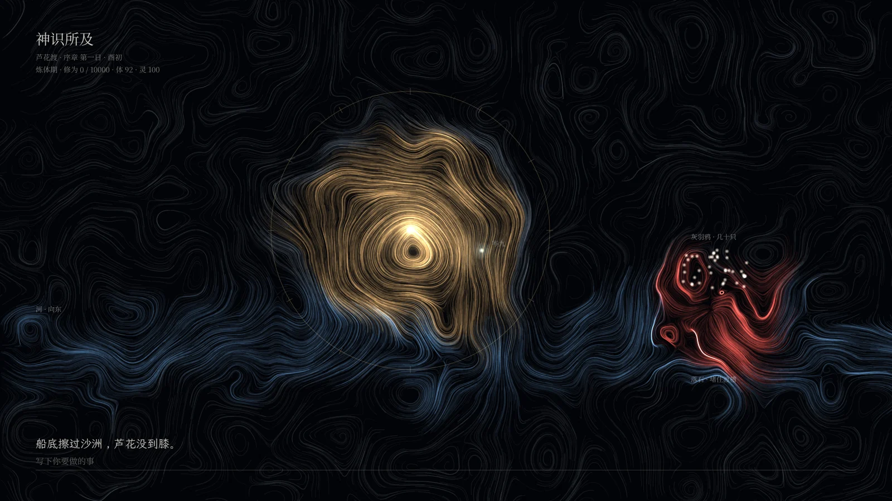

# 04 · 四个原创方向（独立创作初稿）

> **更正（2026-11-26）**：下文“取自线上 1.0 预览版的实际存档”的说法不准确。地点、场景事实和叙述都来自真实内容，但把芦花渡、酉初、开场白与体力 92 拼在了一起，而体力 92 是在望气台环视之后才有的数值。这不是任何一个真实存档。三份盲评都指出了这一点。第二轮起改用真实的状态链，见 [05](05-独立评审与重构.md)。

**状态：初稿，已交独立评审。** 评审意见与据此做的实质修改见 [05-独立评审](05-独立评审与重构.md)，最终取舍见 [06-推荐方案](06-推荐方案.md)。

## 怎样比较才公平

四个方向都画**同一个真实游戏状态**，取自线上 1.0 预览版的实际存档：

- 地点：序章第一日，芦花渡；
- 时刻：酉初，即 gameMinute 1020，规则里的入暮点；
- 场景事实：落石堵住渡槽，石上落着几十只灰羽鸦，岑九撑船；
- 角色状态：体力 92，灵力 100，修为 0/10000（炼体期）；
- 叙述：游戏真实的零模型叙述“船底擦过沙洲，芦花没到膝……”。

这样比的是表达方式本身，不是谁挑了更好看的场景。

四个方向的区别不在配色，而在**以哪一种艺术媒介作为主体**：

| 方向 | 主体媒介 | 一句话命题 |
|---|---|---|
| 甲 · 九霄长卷 | 绘画 | 整个游戏是一卷会呼吸的青绿长卷，玩家走到哪里，卷就展开到哪里 |
| 乙 · 一线天光 | 电影 | 每一刻是一个镜头：地点是一片色场，事件是光，玩家的行动是一条光线 |
| 丙 · 字境 | 文字 | 九霄由字构成，言出法随：玩家写下的字会落进世界、改变世界 |
| 丁 · 灵台 | 物理场 | 修士用神识看世界：界面就是神识，世界是灵气的流场 |

四个方向的依据都能在作者材料里找到：

- **长卷**：作者自己的设计文档里有《北京四季卷轴滑块》；《千里江山图》的青绿传统。
- **一线天光**：参考图 09（绝命毒师式单色荒原）、10、11（贯穿画面的一条光线）、14（地平线光刃）。
- **字境**：参考图 15（公式构成的弯曲空间）；Canon 中稷下学宫“以言为法，以字为兵”、衍天宗的“道纹”、天阶功法“并非文字，而是一幅图、一段音律或是一种意境”。
- **灵台**：参考图 15、17（灵气涡旋）；Canon 中修炼境界本身就是灵力的物态变化：炼气为气、筑基压缩成液态、结丹凝为固态、元婴孕育生命、化神成“法域”。

---

## 甲 · 九霄长卷

**画面怎样构成**

- 绢本青绿山水。主色取《千里江山图》的矿物颜料，石青、石绿叠在赭石底上。山不是平涂：迎光坡被夕照染成暖金，背光处偏冷，山脚化进雾里。颜料受光，是这个方向和“古画贴图”的根本区别。
- 构图按郭熙三远法。左侧高远主峰；中段平远，远山层层变淡；前景一株深墨老松从左侧斜入，形成框景（参考图 01 两棵树构成的门）。
- 渡船与人物都极小，人在天地间（参考图 09、10、12 的尺度关系）。

**界面放在装裱上**

- 天头写卷名和地名，右侧是体力、灵力两条细线。
- 地头是输入行和建议签。提交不是按钮，而是“落印”：一方朱印，盖下即提交。
- 画心里只放叙述。叙述按题跋竖写在留白处，末尾钤玩家的名章，意思是这段事写进了“你的卷”。

**状态驱动**

| 画面 | 真实数据来源 |
|---|---|
| 天色与光向 | `gameMinute`，如 1020 = 酉初 |
| 泥金虚线（当前路线） | 位置图 |
| 落石与鸦群 | 障碍物与战斗目标事实 |
| 题跋内容 | 最近一次结算的叙述 |
| 体力、灵力两条细线 | `stamina`、`spiritStamina` |

画面上的每一处都有对应的规则状态，没有装饰性的假数据。

**九类场景**

| 场景 | 设计 |
|---|---|
| 首屏 | 一卷收着的长卷。拖动或滚轮就是展卷，青绿山水从右向左一段段展开，时辰的光随之扫过；手机上改为立轴从上往下垂落。展到引首停住，写“九霄” |
| 建角 | “题名落款”：在卷首空白处真实书写姓名；出身选一幅卷首小景（渡口船家、医者学徒……）；最后用名字刻一方印，盖在卷首，角色就此诞生 |
| 主场景 | 当前地点是卷中一段。写下行动并落印后，画面推向规则解析出的目标，题跋随之更新；需要澄清时墨迹不干，题跋旁出现小字批问 |
| 长剧情 | 向右回卷就是回看：每回合一段题跋，从右往左按时间排列，章节以印章分隔；可以切到竖排连读 |
| 地图 | 舆图就是全卷鸟瞰。没去过的地方只有白描线稿，去过之后才上色，“探索即上色” |
| 修炼 | 卷中人物入定，背景里时辰的光延时掠过。突破（规则尚未开放）：画幅由手卷转为立轴，画面向上延伸到天，云开一线 |
| 酒馆、群聊 | “雅集图”：每位角色是画中一个人物，发言以题画诗竖写在身旁，按真实顺序排列；每人一方颜色不同的印 |
| 设置 | “装裱”：选绢本或纸本（画质档）、灯下看或日下看（主题）、展卷快慢（动效）；关闭动效后是一张静止的画页 |
| 错误恢复 | “墨未干”：没得到服务器确认的行动以淡墨显示，旁注“未落定”，重新落印即重试；两份记录冲突时，两段题跋并列，由玩家选择保留哪一份 |

**风险**

- 每个地点都需要一段画，资产工作量最大；
- 横向卷轴在网页上不够直观，需要引导；
- 稍有不慎就会落入“古风模板”。必须靠真实的光、天时与动态，避免沦为一张会动的古画。

---

## 乙 · 一线天光

**画面怎样构成**

- 全幅电影画面，画面上方一大片深蓝色场。地平线是一条火色光刃（参考图 14），余晖只集中在太阳方位，水面是长曝光镜面。
- 渡船和鸦群只是地平线上的剪影。
- 字体系统借鉴参考图 11：左上是标签块（地名、章、时辰），右侧竖排一句钩子（“灰羽鸦在石上落着”）。
- 叙述一次只出一句，像电影字幕。
- 输入行就是第二条地平线：一条全宽的细线，聚焦后变暖。

**镜头语法由事件类型决定，不交给 AI 发挥**

| 事件 | 镜头 |
|---|---|
| 观察 | 推近，并给目标一个特写插入镜头 |
| 移动 | 横移跟拍 |
| 交谈 | 正反打 |
| 战斗 | 快切 |
| 修炼 | 延时摄影，云影流过、星轨转动；规则消耗的 `刻` 决定延时长度 |

**九类场景**

| 场景 | 设计 |
|---|---|
| 首屏 | 全黑中亮起一条极细的地平线，横向延展；镜头从高空俯冲到芦花渡水面；片名“九霄”竖排出现在右侧 |
| 建角 | “片头字幕”：玩家的名字作为演员表出现；出身对应不同的冷开场镜头 |
| 主场景 | 如上图。提交后光线沿底线跑过，然后按收据播放 2–4 个镜头 |
| 长剧情 | “剪辑台”：每回合一格缩略帧，可以拖动重看；也可以切到剧本式排版连读 |
| 地图 | 航拍：夜色中的大陆，城市是灯火，路线是延时摄影的光轨 |
| 修炼 | 延时；突破（规则尚未开放）时一道竖直光柱贯穿画面，遮幅打开 |
| 酒馆、群聊 | 对手戏的分镜；每位角色有自己的主光色温 |
| 设置 | “调色”：调色预设、字幕大小、动效 |
| 错误恢复 | 定格加清楚的文字说明，“信号中断，这一步还没落定”，附重试 |

**风险**

- 文字游戏的阅读量大，长段落放不进字幕节奏；
- 需要大量高质量背景，或程序化天空与剪影；
- 可能流于“壁纸加字幕”；
- 室内场景和多人对话的表现力还没想透。

---

## 丙 · 字境

**画面怎样构成**

- 宣纸底上，山由“山岩峦岭峰崖”等字层层堆成，离山脊越近墨越重；水是一行行横向压扁的“水”字，越近越疏；渡船是一个行书“舟”字，上面两个“人”；落石是一堆“石”，鸦群是几十个“鸦”字。
- 当前那句叙述写在天上，作为背景里的大字。
- 这一帧画的是玩家刚写完“去渡口看看那堆石头”：句中的字从输入线上飞起，沿一条朱砂色弧线落向“石”。落点是规则解析出的真实目标，不是装饰。

**九类场景**

| 场景 | 设计 |
|---|---|
| 首屏 | 空白宣纸上落下一个“九”字，笔画散成千万小字，汇成山川 |
| 建角 | 写下姓名，名字的笔画生长成一株树；出身选一个字作为命格（渡、医、樵……） |
| 主场景 | 叙述就是景的一部分，写山的句子悬在山上；玩家的字飞向目标；结果出来后，目标字发生变化，比如“石”出现裂纹，生出“落石线索” |
| 长剧情 | 文字沉积成地层，越早的字沉得越深，可以展开 |
| 地图 | 地名字组成星图（对应衍天宗的星阵），道路是连接它们的笔画。没去过的地方是残缺的字，正好对应 Canon 原图中断处的“…” |
| 修炼 | 功法名的笔画循环流动；突破时文字场弯曲（参考图 15），旧字重组成新的境界名 |
| 酒馆、群聊 | 每个角色有自己的笔迹（楷、行、隶、篆），用笔迹表明身份，参考《Pentiment》用字体表现人物 |
| 设置 | 字号、书体、字景的繁简；读屏时切为纯文本 |
| 错误恢复 | 未确认的字墨迹晕开；数据损坏时出现缺笔的残字，并给出恢复操作 |

**风险**

- 视觉噪音大，可读性有压力；
- 满屏是字，容易让人疲劳；
- 对不熟悉书法的玩家有门槛；
- 只能使用开源字体。

---

## 丁 · 灵台

**画面怎样构成**

- 黑暗中是一张灵气流场：卷曲噪声，加上玩家灵台的旋涡、向东的河流、障碍物的湍流，同一套计算生成全部画面。
- 炼体期的气血是一团暖金核心。河流是向东的冷色流线，落石是一团挡住流线的锈红湍流，鸦群是几十个生命火花，岑九是一团淡青的存在。
- 核心外有一圈“周天”刻度。修为为 0，所以这一圈是空的。

**九类场景**

| 场景 | 设计 |
|---|---|
| 首屏 | 黑暗中一个光点，即灵台初开。它随 4 秒吸、6 秒呼的节律明暗，邀请玩家按住屏幕跟着呼吸，交互本身就是入门的修炼 |
| 建角 | “测灵根”：按住、滑动时，场中五行的颜色比例流动成形。目前没有灵根规则，所以只做表现，不写入任何事实 |
| 主场景 | 流场就是地点。玩家写下的意念化作一道流线投入场中；结果出来后，扰动的结构被看清 |
| 长剧情 | 每次行动在场里留下“迹”，时间轴可以回放场的历史 |
| 地图 | 灵脉图：Canon 写的五域灵气，“中州醇厚均衡”“西荒狂暴且蕴含火毒”“北境极端阴寒”，直接成为大尺度的流场 |
| 修炼 | 境界即物态：炼气是气态粒子，筑基是液态流体，结丹是固态晶体（会折射），元婴孕育出生命，化神形成法域 |
| 酒馆、群聊 | 每个角色是一种气，有自己的颜色和流型；对话时两股气交汇 |
| 设置 | 粒子密度与画质；读屏时把场转成文字描述 |
| 错误恢复 | 场紊乱，噪声增强，同时给出明确的文字说明 |

**风险**

- 太抽象：玩家看不到面孔、器物和人间烟火，具体的地点感弱；
- 不适合承担全部界面，更适合作为一个系统层。

---

## 初稿阶段的自评（只作记录，不当证据）

我对四个方向的初判是：甲的世界感最强，乙首屏的冲击力最强，丙最符合“文字游戏”的媒介本性，丁和修炼玩法结合得最深。

这只是创作者自己的看法。按照协议，评判交给独立评审：评审不知道我倾向哪一个，也没看过方案 E。
