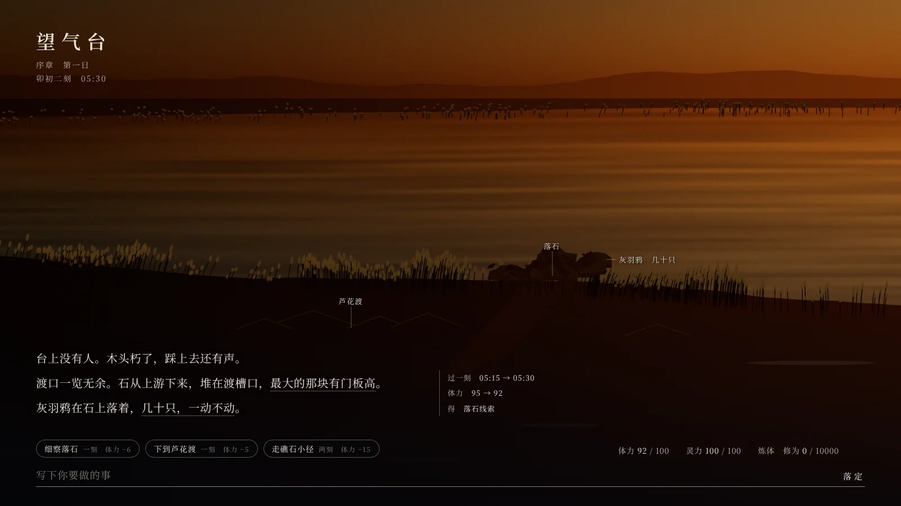
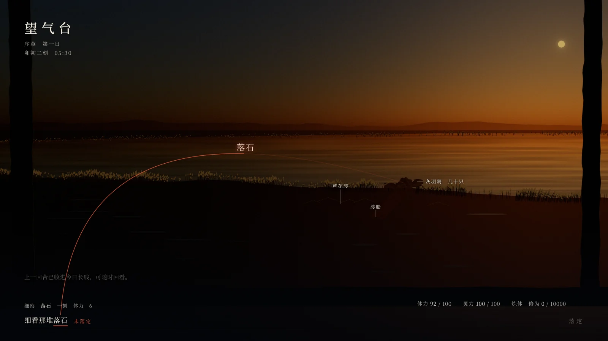
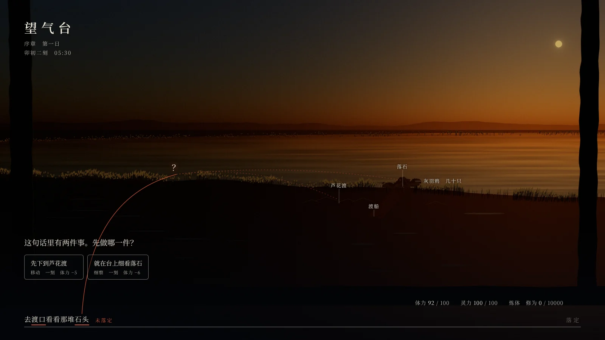
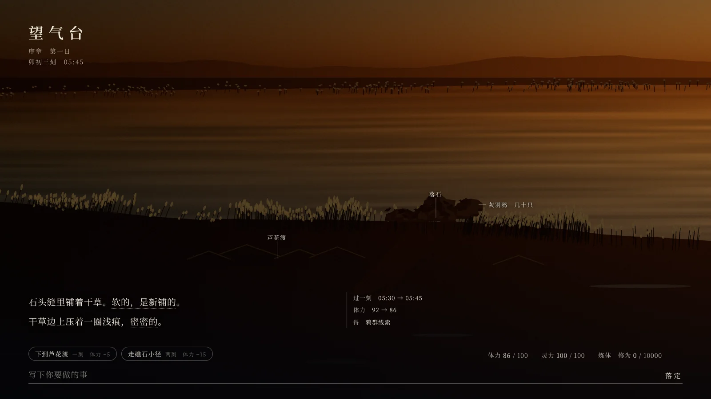
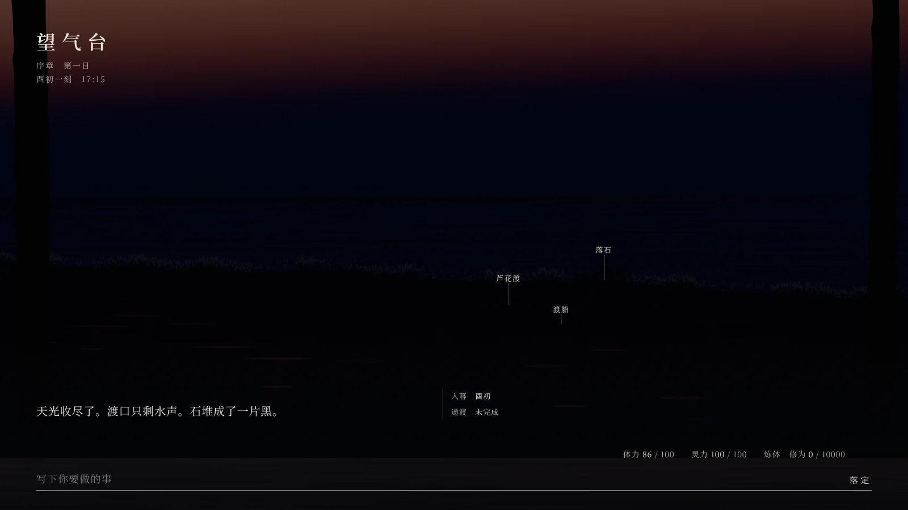
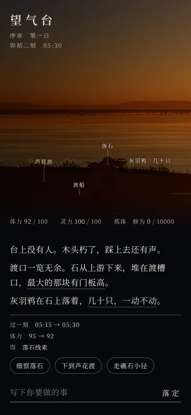
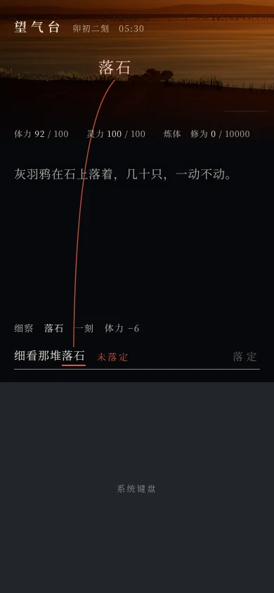
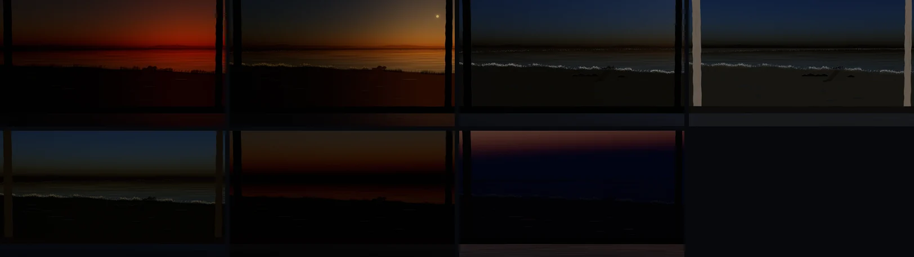

# 06 · 推荐方案：天光

**状态**：第二轮修订后的推荐方案。它不是四个初稿方向中任何一个的直接延续，而是在三份盲评分歧之上重新取舍的结果，经过见 [05](05-独立评审与重构.md)。文中凡写“已验证”的，都有帧图或代码证据；凡写“计划”“实验”的，都还没有做。

## 0. 一句话

**时间就是光。** 《九霄》的每个地点是一幅会受光的画；画上的光由权威的游戏分钟决定，画上能看清的东西由角色已知的事实决定；玩家写下的话，经确定性解析后，那个被解析出的目标词会落到画中那个物件上。

| 主方案 · 天光 | 备选方案 · 卷宗 |
|---|---|
| 以画为体：每个地点是一组手绘分层画板，按游戏时刻重新打光 | 以文为体：屏幕是一页排印精良的卷宗，画面只占一扇小窗 |
| 资产成本高，依赖画师产能（实验 E9） | 资产成本低，阅读与无障碍最好 |
| 签名交互：言落（目标词落到画中物件上） | 签名交互：摘句为证（叙述里的事实短语被摘成证物签，放进卷宗） |

两个方案共用同一套真实状态管线、同一套解析与“未落定”状态机。所以先做的管线工作不会浪费，选哪一个由 P0 实验结果和作者的审美来定。

## 1. 为什么是这个方向

依据按强弱排列，最强的放前面：

1. **游戏内容本身就是用光写的。** 这不是我的发挥，序章文本里直接写着：
   - 开局在卯初（05:00），入暮在酉初（17:00）；规则的一天恰好是从日出到日落的 12 小时。
   - 望气台的夜间文本是“天光收尽了。渡口只剩水声。石堆成了一片黑。”（`prologue-v1.ts`，gameMinute ≥ 1020 时出现）。
   - 体力耗尽的文本是“天色暗下来，你的手在抖。”
   - 通渡之后，岑九说的是“通了。明早第一趟。”

   让画面上的光严格跟着 `gameMinute` 走，就是把规则里已有的时间压力变成看得见的东西。玩家看到天色在变暗，就知道这一天还剩多少刻。
2. **作者参考图里最稳定的规律**：9 张图的中位亮度只有 0.15–0.29，最亮的 3% 像素集中在竖向中轴附近（[02](02-参考58图登记.md)）。也就是大面积统一的色场里，只有一个强光源，人物极小。“一线光”“门与框”在参考图里反复出现。
3. **三份盲评的交集**（[05](05-独立评审与重构.md)）：
   - 三方都要“字飞向规则解析出的目标”这一交互；
   - 三方都要地点画得真实，手机取景里必须有当前目标；
   - 技术评审建议以“画”为体、以统一天光为渲染核心；
   - 美术评审否决青绿、松框、孤舟这套国风默认图式；
   - 游戏评审要求叙述永远可以横排读全文，并提出“摘句为证”。

   天光就是这些条件的交集。
4. **玩家调查**（只有 8 人）：62.5% 的人最想要“把我的话变成行动”。言落和摘句为证都直接回应这一点。

## 2. 已经做出来的东西（第二轮原型，非生产代码）

源码在 [lab/dawn.html](lab/dawn.html) 和 [lab/js/sky.js](lab/js/sky.js)。地面是程序化剪影，只是占位；正式实施时由画师绘制，见 §6。原型在浏览器里实时计算，没有一张预先画好的天空图。

| 帧 | 真实状态 |
|---|---|
|  | 望气台，卯初二刻 05:30。环视后得到落石线索，体力 95→92，叙述是游戏原文。镜头按“观察 = 推近”语法推近 |
|  | 玩家写“细看那堆落石”。解析结果是细察、目标落石、一刻、体力 −6，提交前预览。“落石”二字沿弧线飞向画中的石堆，状态为“未落定” |
|  | 复合句“去渡口看看那堆石头”：飞行停在半路，分成两个去处；给两个选项，各自标明动作类型和代价 |
|  | 05:45，得到鸦群线索，体力 92→86。叙述是游戏原文；建议签只列望气台此刻规则允许的行动 |
|  | 同一地点 17:15，酉初一刻。夜间文本是游戏原文。东方天际的粉带和其下的暗带是地影与“维纳斯带”，由散射计算自然出现，不是手画的 |
|   | 手机：画面占上方约 56%，取景以目标物为中心；数值显示数字；叙述 17px，行高 1.8。键盘弹起时画面收成一条，只保留目标物、上一句叙述和解析预览 |
|  | 同一画面，按顺序为 05:00、05:30、08:00、12:00、16:00、17:00、17:15。午间和 16:00 偏暗偏灰，这是单次散射模型的已知缺陷，见 §7 |

## 3. 设计规律（用数写，不用形容词）

### 3.1 时间即光

太阳位置（游戏天文是设计提议，不是已签规则）：

- 采用春分几何、纬度 30°，正午定在 11:00，使日出 = 05:00 = 卯初、日落 = 17:00 = 酉初，与规则对齐。
- 时角 `H = (t_hours − 11) × 15°`。
- 太阳高度 `sin h = sin φ sin δ + cos φ cos δ cos H`，其中 δ = 0。
- 方位角 `A = atan2(−sin H, tan δ cos φ − sin φ cos H)`。

天空用单次散射（Nishita 式）：

- 瑞利散射系数 β_R = (5.8, 13.5, 33.1)×10⁻⁶ m⁻¹，标高 8 km；
- 米氏散射系数 β_M = 21×10⁻⁶ m⁻¹，标高 1.2 km，相函数用 Cornette–Shanks，g = 0.76；
- 臭氧吸收 β_O = (0.65, 1.881, 0.085)×10⁻⁶ m⁻¹，暂用瑞利的密度剖面近似。它让晨昏的天顶保持蓝色；第二轮加入前，天顶偏橄榄灰。

其余光照项：

- **视线积分**：主光线 10 个采样点，光线 5 个。
- **水面**：Schlick 菲涅耳 `F = 0.02 + 0.98(1 − sin θ)^5`，θ 为俯角，近处见水色，远处见天光。水色取“水发黄”的淤黄。
- **日光闪烁**：小面斜率模型。镜面反射所需的小面倾角为 `τ² = (Δyaw² + (pitch − h)²)/4`，出现概率 ∝ `exp(−τ²/2σ²)`，σ = 0.09 rad，对应微风下的水面。
- **空气透视**：`L = L₀·T + L_horizon·(1 − T)`，`T = exp(−d / 5.2 km)`。
- **色调映射**：ACES 拟合曲线加 sRGB。随后按地点做一层“调色”：暗部偏冷、亮部偏暖。调色是摄影指导的选择，与物理分开，只作为单独一层参数。

正式实施时，换用 Hillaire 2020 的透射率、多次散射与天空视图 LUT（见 [03](03-研究与来源.md)），解决午间偏暗、偏灰的问题。

### 3.2 画面清单（SceneSpec）

画面清单是一个纯函数：`(locationId, gameMinute, visibleFacts, viewport) → { plates, light, anchors, mustShow, cameraShot, altText }`。

- **画面上每个可读的元素都绑定一个事实键**，没有对应事实就不画、不标：

  | 元素 | 绑定的事实 |
  |---|---|
  | 落石 | `obstacle_rockslide.state` |
  | 鸦群 | 战斗目标的事实 |
  | 渡船 | `aground` |
  | 南边那片白 | 只在 `text_south_white_hook` 已投放后出现 |

- **`mustShow` 是必须入画的锚点**，即当前任务目标与最近一次事件的目标。取景算法保证它们在两种画幅里都在视口内，且可点区域 ≥ 44×44 px（实验 E2）。原型手机帧的取景就以石堆为中心算出。
- **次要锚点碰撞**：落进叙述、账本、建议签、输入区的次要标签自动隐藏（原型已实现）；必入画锚点则通过调整取景避开这些区域。
- **`altText`** 由同一份清单按模板生成，零模型调用，读屏用户听到的画面与看到的画面一致。

### 3.3 知者可见

- 锚点名只在角色知道之后出现。环视之前，石堆只是一团暗影，不标“落石”。
- 这要求服务器提供**按可见性过滤的视图接口**。现在的完整 facts 会泄露剧透（[01 §5](01-基线与实测.md)）。

### 3.4 镜头语法（由事件类型决定，不交给 AI）

| 事件 | 镜头 | 时长 |
|---|---|---|
| 观察（scan / study） | 推近，以目标为中心，焦距约 ×2 | 0.6 s |
| 移动 | 横移到新地点的画板；跨地点时做一次叠化 | 0.8 s |
| 交谈 | 收成两人取景，NPC 白描半身像亮起 | 0.5 s |
| 战斗（打鸦） | 2–4 拍快切，结果分撤退、清障、清障带伤三种 | 每拍 0.25 s |
| 修炼 | 延时：光掠过画面，时长 = 消耗刻数 × 0.3 s，上限 2 s | — |

所有镜头都可以点击跳过。开启“减少动态效果”时，一律改为直接切换。

### 3.5 言落：签名交互的状态机

```
输入中 ──(本地解析：packages/domain/nlu，与服务端同一份确定性解析器)──▶ 目标词朱砂下划线 + 预览（动作类型、目标、刻、代价）
  │提交（带 idempotency key）
  ▼
飞行中（“未落定”：目标词从输入行升起，沿弧线飞向锚点；全程不超过 0.7 s）
  ├─ 服务端 accepted ─▶ 落定：词落在物件上，锚点亮一次；账本列出 stateDelta；随后叙述到达
  ├─ 服务端 clarify  ─▶ 停在半路，分叉指向各个候选；显示追问和选项，每项都标代价
  ├─ 服务端 rejected ─▶ 词落回输入行，用一句话说明规则拒绝码对应的原因，例如体力不足、道路受阻
  └─ 网络失败/超时   ─▶ 词停在原处，显示“这一步还没落定”和重试；用同一个 idempotency key 重试，不会重复结算
```

规则：

- **只有解析器给出了目标，才播放飞行。** 复合句必定进入追问。没解析出来的东西，绝不播放动画。
- 目标词按它在句中的原有字序作为一个整体飞行，不会出现倒序。
- 读屏只播报一次结果。焦点留在输入行。
- 依赖：提交响应要先返回事件与 `stateDelta`，叙述随后另取。这样“落定”不必等叙述生成。现在是同一个请求、不流式（[AI 档案](appendix/dossier-api-ai-cards.md)），所以要拆成两步，见 §5。

### 3.6 摘句为证（来自游戏设计评审，主方案与备选都采用）

- **读即采证**：叙述里对应账本事实的短语，例如“最大的那块有门板高”“几十只，一动不动”，在观察或交谈之后显示虚线（原型已画）。每段最多 2–3 处；纯修辞的句子不可摘。
- **写即引证**：点或长按这类短语，它就变成输入行里的一枚证物签，例如〔落石·门板高〕。证物签携带事实 ID，解析器得到结构化的目标，玩家在手机上只需补几个字。
- **世界按记忆回应**：NPC 的回答取决于其记忆线里有没有这件事。手上没有的事实摘不出来，所以不可能凭空引用。
- **工程量**：
  - 模板叙述要标注片段与事实 ID 的对应。模板本来就是从事件生成的，基本是现成的。
  - AI 叙述只能在附带的事实签上标注，由服务端校验器检查。
  - 解析器要接受事实 ID 签。
  - **不需要新的游戏规则。**

### 3.7 读写版式

- 叙述永远是 DOM 横排全文，不画进画布。
  - 桌面：20px，行宽不超过 34 个汉字，行高 1.85。
  - 手机：17px，行高 1.8。
- 题跋式的竖排只允许用于不超过 2 句的地名或章名。
- **对比度**：文字框下的背景按每个时刻采样，小字 ≥ 4.5:1，大字 ≥ 3:1（实验 E6）。不达标时，由程序只在文字下方局部压暗。原型用的是固定的底部压暗，还没有逐时刻测量。
- **账本**：每回合列出真实增量，即时间、体力、线索。数值显示为数字，不只是一根线。
- **建议签**：只列当前地点、当前状态下规则允许的行动，每个都标代价。

### 3.8 今日长线（历史，取代“长卷”）

- 画面底部的输入线本身就是今天的时间轴：卯初在左，酉初在右，共 48 刻。
- 每个回合在线上留一个刻痕，点开即可读到那一回合的全文和账本。
- 多日的长线叠起来，就成了玩家自己的“卷”。这保留了游戏评审最看重的、可以累积的个人产物，却不使用古画装裱的图式。
- 原型里还没有画出长线。

### 3.9 人物、交谈、战斗、修炼

- **人物**：每个 NPC 一幅白描半身像，由画师绘制，可按状态换光。岑九的形象只用内容里已有的描写：“常年日晒，手背裂口深；左耳缺一角，早年与鸦群抢食留下”。
- **交谈**：两人取景；岑九的话用一种书体（原型里给他的话用了霞鹜文楷），玩家的话用正文体。
- **战斗**：打鸦的结果有三态，确定性裁决：清障、清障带伤、撤退，分别对应 `text_combat_*` 原文。
- **修炼**：只表现时间流过。规则签署突破之前，不画任何境界变化；“境界即物态”（灵台方向）留到那时再用，且只用于修炼。

以上四项都**还没有画帧**，见 §7。

## 4. 九类场景

| 场景 | 主方案 · 天光 | 现状与诚实标注 |
|---|---|---|
| 首屏 | 黑场中天光从地平线亮起，按访问者本地时间对应到最近的一个时辰。只有一行字“九霄”，以及“进入”。不放任何解释性句子（这与开局文本的 `firstScreenConstraint` 一致） | 可做 |
| 建角 | 在芦花渡的晨光里，岑九撑船靠岸前的一拍。名字写在船头那块空白里，写完船靠岸，接上开局文本“船底擦过沙洲，芦花没到膝……” | 出身、灵根没有规则，不做选择项 |
| 主场景 | 见 §2 的帧 | 可做；画板需要画师 |
| 长剧情 | 今日长线与多日的卷 | 生产环境要保存叙述（见 §5） |
| 地图 | **不做**。地图系统不存在之前，不放入口 | 未实现 |
| 修炼 | 延时光 | 突破未实现，不暗示 |
| 酒馆、群聊（已有功能） | 同席：每位角色一盏灯（色温不同），发言横排，名字前有一枚小像 | 可做，与卡片系统对接 |
| 设置 | 画质三档：静态图、只在状态变化时出帧、完整动画；减少动态效果；环境声（默认关）；字号 | 可做 |
| 错误恢复 | 未落定状态机，见 §3.5；冲突一律以服务端为准，只允许丢弃本地尚未确认的那一份 | 可做 |

## 5. 全栈方案

### 前端

- React 19 + Vite 保持不变。全屏 `<canvas aria-hidden>` 只负责画面；所有文字都是 DOM。
- **渲染器**：原生 WebGL2，或 OGL（MIT）这一量级的小库。片元着色器负责天空、水面、画板打光与空气透视。
- **按需出帧**：只在镜头与言落时出帧，空闲后降到 0 fps。手机画布 DPR 上限 1.5，帧率上限 30。处理 `webglcontextlost`。
- **三档**：
  - T0：静态 AVIF。每个地点按 8 个时刻预先烘焙；无 WebGL、省流量、内置浏览器出问题时使用。
  - T1：只在状态变化时打光一次。开启“减少动态效果”时用这一档。
  - T2：完整动画。
- 天空 LUT 可以在 Worker 里计算，或在构建时预算成每个地点、每刻的小纹理，不让手机实时积分。
- **字体**：自托管，按 `unicode-range` 切片，使用国内可达的源。正文用思源宋体（Noto Serif SC），NPC 话语用霞鹜文楷，均为 OFL。
- **本地解析预览**：直接复用 `packages/domain/nlu` 的 `parseActionText`，Web 端已经引用过它的候选版。服务端结果永远优先。

### 后端（Hono / Node + PostgreSQL）

1. **拆分提交**：`POST /turns` 只返回事件与 `stateDelta`，加上一个叙述句柄；`GET /turns/:id/narration` 取叙述，以后可以改为流式。幂等键与事件链保持不变。
2. **可见性视图**：`GET /games/:id/view` 返回按角色已知事实过滤的投影，供 SceneSpec 与锚点使用。
3. **叙述持久化**：生产环境保存每回合的叙述文本、片段与事实 ID 的映射、模型或模板的来源，今日长线和“回看”要靠它。需要同时写明隐私与保存期限，并由作者批准。
4. **证物签**：契约里 `ActionInput` 增加可选的 `evidence: FactRef[]`。解析器优先使用证物签；服务端校验引用的事实对该角色可见。
5. **AI 叙述约束**：模型只能在附带的事实签上标注片段，校验器拒绝任何不在本回合事件里的事实 ID。AI 仍然不写事实。

### 测试与验收（每条都可以自动化）

- **画面 ⊆ 事实**：对每个状态快照，SceneSpec 的锚点集合必须是可见事实集合的子集。
- **必入画**：在 390×844、834×1194、1440×900 三档视口下，必入画锚点都在视口内。
- **对比度**：24 小时 × 每刻采样，文字框下的对比度达标。
- **言落状态机**：accepted、clarify、rejected、超时重试四条路径各一个 e2e，断言“没解析出来就不飞”。
- **读屏**：NVDA + Chrome、VoiceOver iOS、TalkBack 三种组合都能独立完成序章闭环（实验 E7）。

## 6. 资产生产

- **每个地点一组画板**：远景、中景、近景、前景框四层，每层有固有色、受光遮罩、深度或法线、天空遮罩。按 16:9 与 9:19.5 两种画幅标注取景锚点。
- **目标产能**：一个地点两种画幅、可以重新打光，不超过 3 人日（实验 E9）。超过 5 人日就说明不可扩展，转向模块化套件，或者改走备选方案“卷宗”。
- **序章需要**：
  - 3 个地点：芦花渡、望气台、折桂坪；
  - 2 个子地点作为镜头取景：渡口作业位、礁石小径；
  - 1 幅岑九的白描半身像；
  - 鸦群与落石的可替换图层，对应 blocked 与 cleared 两种状态。
- **授权**：委托创作要签书面的著作权转让或独占许可。AI 生成的图只用于内部概念，不进入发布资产；这一条请作者确认（[09](09-未决决策.md)）。
- **不需要实时 3D**。原型证明，打光的大部分价值来自天空与水面，而这两样都是二维着色。

## 7. 诚实的缺陷清单（第二轮原型）

1. **地面是程序化剪影，只是占位**，容易被认成《Alto's Odyssey》式的分层剪影。正式质量取决于画师；原型只验证了光、版式和状态管线。
2. **单次散射的缺陷**：午间和 16:00 偏暗偏灰，反日方向偏绿；缺多次散射与地面反照。
3. **还没画的部分**：交谈帧、岑九小像、战斗帧、今日长线，以及首屏、建角、设置。
4. **曝光固定**：每个时刻都按天空亮度自动曝光，但还没有做人眼适应的平滑过渡。
5. **手机键盘**用灰块示意，没有在真机上测过键盘遮挡。
6. **对比度还没做逐时刻测量**，原型用的是固定的底部压暗。
7. **游戏天文**（日出 05:00、正午 11:00）是设计提议，需要作者确认，见 [09](09-未决决策.md)。

## 8. 备选方案 · 卷宗（与主方案根本不同的路线）

**命题**：《九霄》首先是一部可以玩的书。屏幕是一页卷宗，世界在文字里展开，画面只是卷宗上的一扇小窗，同样按时刻受光。

**适用条件**：
- E9 实验证明画板产能不可扩展；
- 或 E10 阅读测试显示，以画面为主的版式拖慢阅读超过 10%；
- 或作者更看重文字的分量。

**它与主方案的根本不同**：

| | 主方案 · 天光 | 备选 · 卷宗 |
|---|---|---|
| 视觉主体 | 地点画面，满屏 | 排印的页面；画面是约 1/4 屏的小窗 |
| 签名交互 | 言落：目标词飞进画中物件 | 摘句为证：证物签被收进卷宗的“证”栏，成为可以引用的材料 |
| 资产 | 每个地点一组画板 | 每个地点一幅小窗画；版式与字体投入更大 |
| 优势 | 世界感、记忆点 | 阅读吞吐、无障碍、手机、成本 |
| 风险 | 美术产能；“壁纸加字幕” | 容易变回“网页小说”；需要非常好的排印 |

两条路线共用 §3.2 到 §3.7 的全部机制与 §5 的后端改动，所以 P0 与 P1 的工程工作在两条路线之间可以复用。

**状态**：只有方向说明，**没有画帧**。如果作者想比较两者，下一轮可以按同一状态，为卷宗画一组手机帧和桌面帧。
