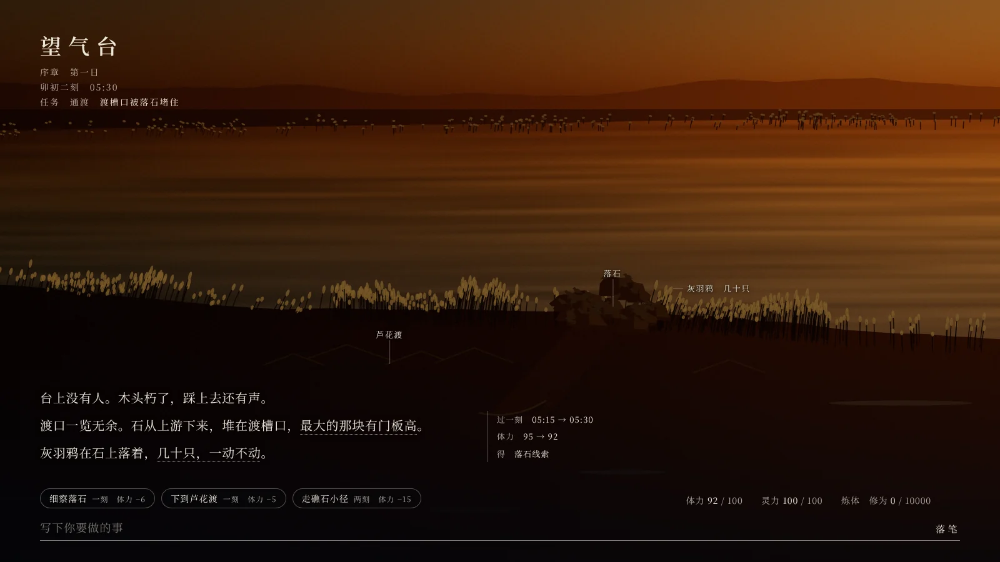

# Claude 独立研究与方案（JX-VISION-02）

本目录是 Claude 按 [完整任务书](../05-claude-master-brief.md) 与 [创作评价协议](../07-creative-critique-protocol.md) 完成的独立研究、设计方向、评审记录和推荐方案。这里只有研究与设计文档，以及非生产的设计证据：没有改生产代码，没有部署，没有动生产数据，也没有产生任何费用。

| 项 | 值 |
|---|---|
| 研究分支 | `docs/vision-02-claude-research` |
| 起点 | `docs/vision-02-art-direction` @ `4f1c314`（PR #121） |
| 堆叠关系 | #121 叠在 #120（`767ad5d`）之上，#120 叠在 #119（`9c0724f`）之上；`main` 为 `f1fe6ea` |
| 线上版本（2026-11-25 核对） | Cloudflare Pages 生产部署 `85adf881`（直传，源码 `c4c672f`）；`/health` 与 `/ready` 正常 |

## 结论

**推荐主方案“天光”**：时间就是光。每个地点是一组手绘画板，由权威的 `gameMinute` 重新打光；画面上只出现角色已知的事实；玩家写下的话经确定性解析后，被解析出的目标词落到画中那个物件上，称为“言落”。

**备选方案“卷宗”**：以文为体，核心交互是“摘句为证”。

在两者之间做选择之前，要先跑 P0 的实验（E1、E9、E10）。两条路线共用同一套状态管线，先做的工程工作不会浪费。



## 目录

| 文件 | 内容 |
|---|---|
| [01-基线与实测](01-基线与实测.md) | 版本基线、全仓阅读账、线上三档设备走查、“平庸”的根因、真实约束、顺带发现的 9 个缺陷 |
| [02-参考58图登记](02-参考58图登记.md) | 58 张参考图逐图登记、测量与规律；原图与私人内容不公开 |
| [03-研究与来源](03-研究与来源.md) | 联网研究，按来源分级 |
| [04-四个原创方向](04-四个原创方向.md) | 第一轮四个方向：长卷、天光、字境、灵台；开头有一条更正 |
| [05-独立评审与重构](05-独立评审与重构.md) | 三份盲评、第二轮评审，以及三轮修改的逐条记录 |
| [06-推荐方案](06-推荐方案.md) | 天光与卷宗：设计规律、言落状态机、摘句为证、全栈方案、资产与诚实的缺陷清单 |
| [07-实施路线与工具](07-实施路线与工具.md) | P0–P4、实验 E1–E12 的通过标准、工具、成本、需要授权的事项 |
| [08-制度修订候选](08-制度修订候选.md) | 345 份 Markdown 的分类与冲突矩阵摘要 |
| [09-未决决策](09-未决决策.md) | 需要作者裁定的 10 件事 |
| [reviews/](reviews/) | 评审原文，未删改 |
| [appendix/](appendix/) | 全仓档案、参考图分组汇总、Markdown 冲突矩阵与全量分类 |
| [frames/](frames/) | 第一轮（根目录）、第二轮（`v2/`）、第三轮（`v3/`）的帧图 |
| [lab/](lab/) | 帧图的源码，不是生产代码。`dawn.html` 是第二、三轮的天光原型；`js/sky.js` 是单次散射天空 |

## 怎样复现帧图

```bash
cd docs/design/JX-VISION-02/claude-proposal/lab
```

```bash
npm i @fontsource/noto-serif-sc lxgw-wenkai-webfont
```

```bash
python3 -m http.server 8731
```

然后打开 `http://127.0.0.1:8731/dawn.html?stage=result`。

- `stage` 可选：`result`、`flight`、`clarify`、`study`、`night`；
- `mode=phone` 切换为手机画幅；加 `kbd=1` 为键盘弹起状态；
- `minute=` 可以指定任意游戏分钟。

第一轮的 `scroll.html`、`words.html` 还另外依赖 `@fontsource/zhi-mang-xing` 等字体，所有字体均为 OFL。

## 没有做到的

- 交谈、战斗、首屏、建角、今日长线、备选方案“卷宗”都还没有画帧。
- 地面画面是程序化占位。鸦群在晨光中看不清。
- 第三轮修改之后没有再做盲评。
- 没有做真机测试，也没有逐时刻测量对比度。
- 境界顺序等事项需要作者裁定，见 [09](09-未决决策.md)。
