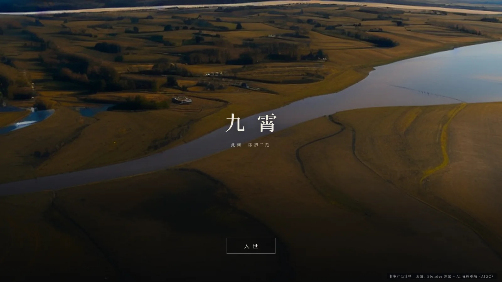
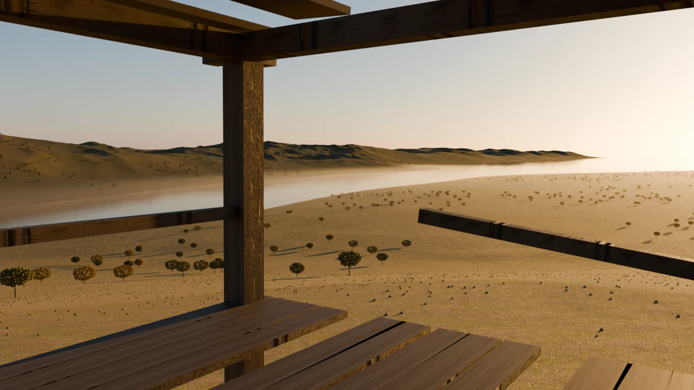
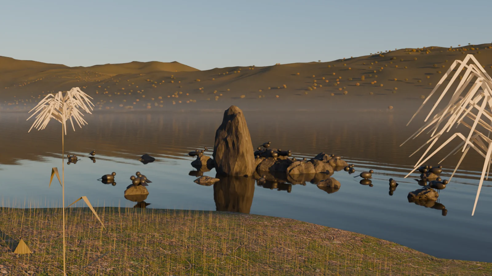
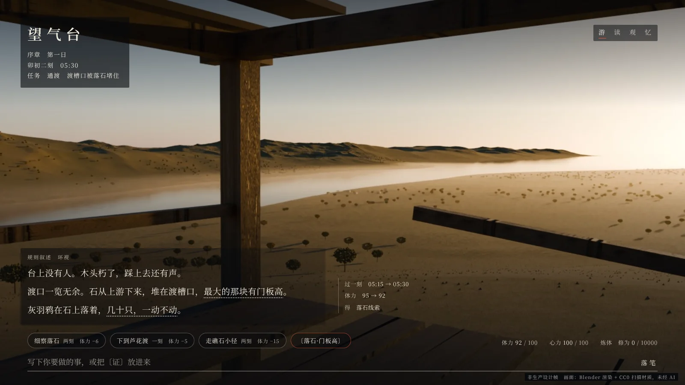
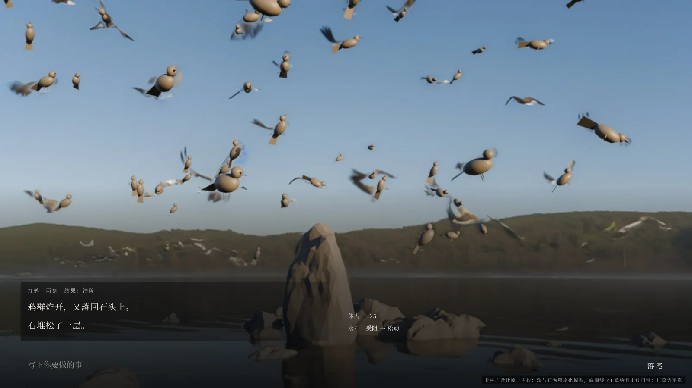
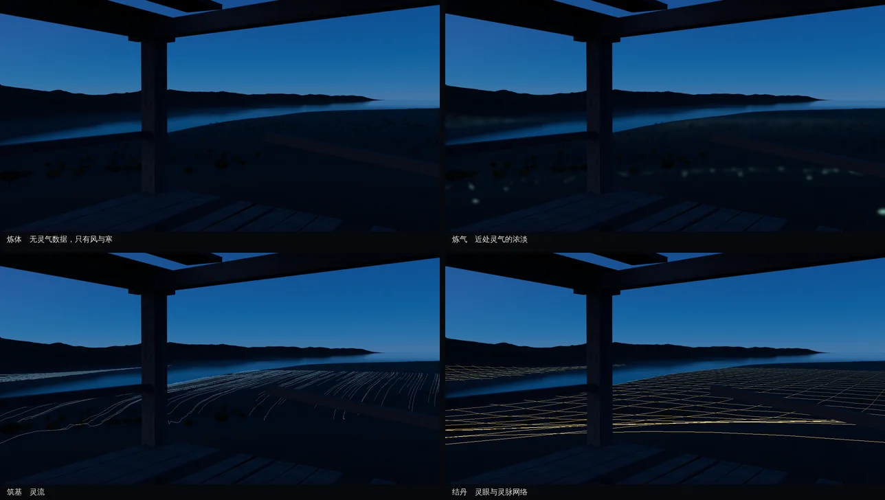
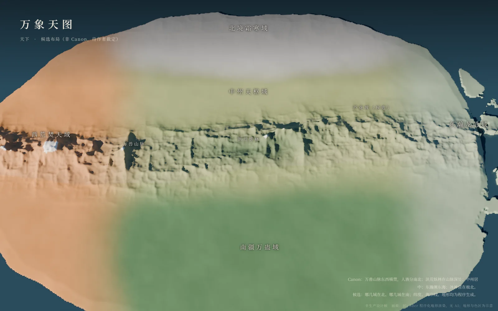
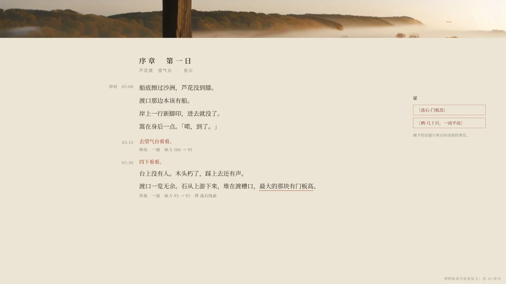
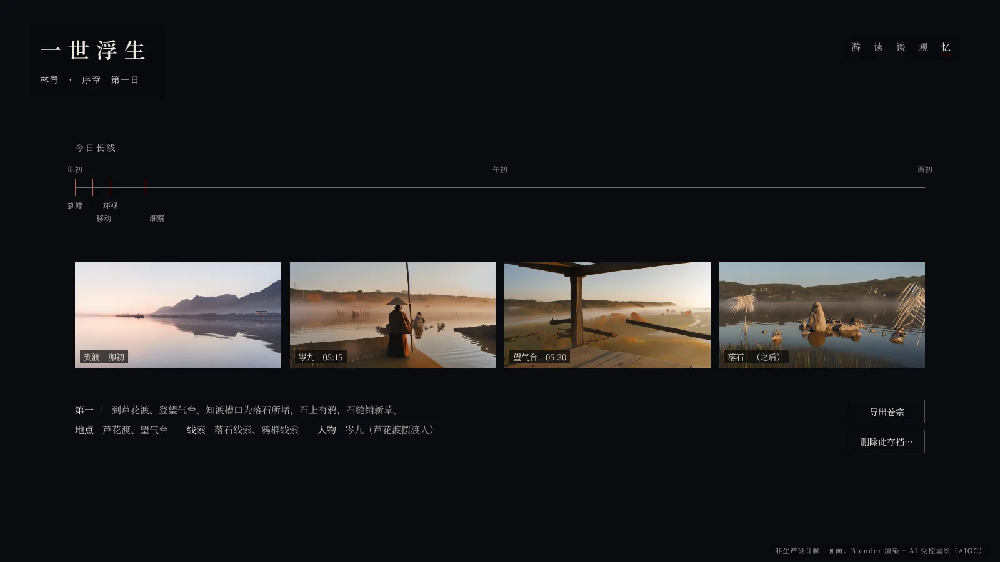
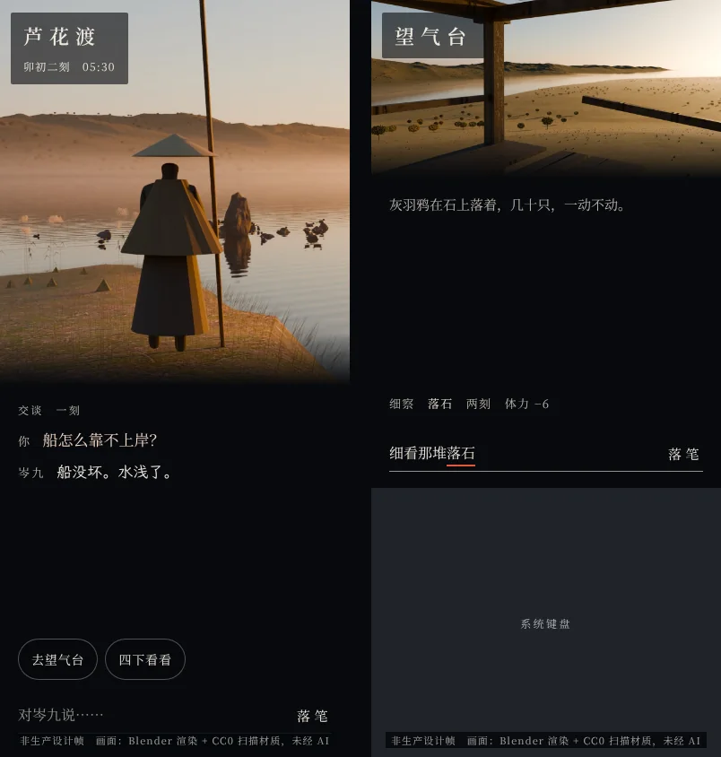

# 03 · 完整玩家旅程与场景设计

**标注**：

- 【已有】线上已有的功能；
- 【改造】已有，但要按本方案重做；
- 【新】新功能；
- 【后续】依赖新 Canon 或新规则，排在后面的阶段。

帧图都是本轮非生产的设计证据，不是线上画面。帧图中的叙述均为序章内容原文（`packages/content/src/prologue/prologue-v1.ts`）。

**帧图状态**（门禁见 09 §4）：

- 标 **〔AI·未过门禁〕** 的帧：Blender 渲染加 AI 整图重绘，用来展示构图、光与氛围的方向。它们在事实、地点或地理一致性上没有通过审阅，**不代表**推荐管线的成品。
- 标 **〔CC0 渲染〕** 的帧：推荐主管线的雏形，未经 AI。
- 标 **〔占位〕** 的帧：只验证几何与状态，美术未达标。

## 序章的真实状态链（全部帧图以此为准）

主线取自上一轮线上走查的真实存档（开局 → 移动 → 环视），之后一步按规则常量推演。

| 时刻 | 地点 | 事件 | 体力 | 线索 |
|---|---|---|---|---|
| 卯初 05:00 | 芦花渡 | 开局：岑九撑船靠岸 | 100 | — |
| 05:15 | 望气台 | 移动，−5，1 刻 | 95 | — |
| 05:30 | 望气台 | 环视，−3，1 刻 | 92 | 落石线索 |
| 06:00 | 望气台 | 细察落石，−6，**2 刻** | 86 | 鸦群线索 |
| 酉初 17:00 起 | 望气台 | 天黑；观察落石被规则拒绝（`too_dark`），出现夜间文本 | — | — |

- 常量取自 `prologue-v1.constants.ts`：移动 5、环视 3、细察 6，细察耗 2 刻。上一轮（v3）把细察后的时刻写成 05:45，按规则应为 06:00，本轮更正。
- **交谈帧（05:15）是另一条分支**：开局先在芦花渡与岑九交谈，体力不变、耗 1 刻。
- **打鸦帧是示意**：只表现规则的三态结果，不对应上表中的某一步。

---

## 1. 网站加载与首次进入【改造】

- **0–300 ms**：纯 DOM 的黑场，中央出现一道极细的地平线；字体与首屏 AVIF 并行加载。
- **300 ms–1.5 s**：静态的天光首帧，即 T0 档的 AVIF，按访问者本地时间对应到最近的九霄时辰。地平线的亮度随加载进度变化，不使用进度条。
- **1.5 s 后**：如设备可用，T1/T2 档的天空接管，同一帧无缝替换。弱网或 WebGL 不可用时，停在 T0 静帧，没有任何错误提示。
- **声音**：默认关闭。首次点击“入世”时才创建音频上下文（iOS 的自动播放限制）。

## 2. 首屏、世界介绍与进入仪式【改造】

- **画面**：从高空俯瞰芦花渡所在的水口。这是“万象”的第三个尺度“地”，晨光沿河谷推进。
- **文字**：只有“九霄”两个字，加一行入口“入世”。“世界介绍”不放在首屏，放到“读”形态里，可以随时翻阅。
- **进入仪式**：点“入世”，镜头沿真实地理从高空降到水面低机位，用时 2.4 s，可以跳过。落到第 3 段的“到渡”画面，与开场叙述衔接。
- **回访者**：首屏的天光换成存档里的游戏时刻，画面就是上次离开的地点。

## 3. 账号、读档与角色创建【改造】

- **账号与读档**：放在“忆”形态里，即一本存档册，每个存档显示地点缩略图、游戏时刻和最近一句叙述。云档可以通过链接找回，修复“云端游戏找不回”的问题。
- **建角**：在晨雾的水面上完成。玩家写下名字；出身与灵根没有规则，所以不做选择项，只问名字与一句“你为何来渡口”。这句话是自由文本，记入卷宗，不产生任何规则效果，并且明确告诉玩家这一点。

**开场**：画面是上图。叙述逐段出现，节奏由玩家点击控制：“船底擦过沙洲，芦花没到膝。／渡口那边本该有船。／岸上一行新脚印，进去就没了。／篙在身后一点。「喏，到了。」”首屏不出现解释性句子，这是内容的约束 `firstScreenConstraint`。

## 4. 序章：芦花渡 → 望气台 → 折桂坪【改造】

| 地点 | 远 | 中 | 近 | 微 |
|---|---|---|---|---|
| 芦花渡 | 俯瞰水口（首屏） | 岸上平视渡槽与落石 | 交谈两人景 | 船底板缝里的芦籽（细察船底） |
| 望气台 | 台上远望渡口 | 长焦推近落石 | 朽木台面与台柱 | 石缝里的干草（细察落石） |
| 折桂坪 | 坡上俯瞰渡口（通渡之后解锁） | — | — | — |

长焦推近帧（`frames/tele-0530.webp`）是失败样例：AI 先画出西式农舍，改提示后又画成了沙滩茅屋。保留它，只为记录失败。

**同一地点，四个时刻**：光由天文公式按游戏分钟计算。

**通渡之后**：同一机位，落石散开，渡槽口露出水面，对应文本“石堆散了。渡槽口露出一段黑黢黢的水面。远处有桨声。一下，又一下。”

## 5. 自由行动、观察、线索、言落与摘句为证【改造，新】

**一个回合的完整链条**：

1. **读**：叙述是 DOM 横排。对应账本事实的短语带虚线，例如“最大的那块有门板高”，每段最多 2–3 处。
2. **写**：可以自由输入，也可以点建议签，或长按虚线短语把它摘成证物签〔落石·门板高〕放进输入行。本地的确定性解析器（`packages/domain/nlu`，与服务端同一份）实时预览：动作类型、目标、刻数、代价。
3. **落笔**：被解析出的目标词从输入行升起，沿弧线飞向画中锚点，状态显示“结算中”。
4. **结算**：服务端先返回事件与 `stateDelta`；词落到物件上，锚点亮一次，账本列出增量；随后叙述到达。
5. **追问**：复合句或有歧义时，飞行停在半路，给出选项，每项都标明代价，另附“改写这句话”。
6. **失败**：网络中断时，词停在原处，显示“这一步还没落定”和重试；同一个幂等键，不会重复结算。

**摘句为证的规则**：

- 证物签携带事实 ID；服务端校验这个事实对该角色可见，并且确实成立。
- 摘不出没有获得的事实。
- 引错地方时，得到确定性的平淡结果（例如岑九说“你问这个，我答不上来”），并扣除真实代价。

## 6. 人物交谈、交易与关系【改造】

交谈发生在 05:15，此时玩家还没有环视，所以这一帧**没有**〔落石〕证物签；玩家提到石头只能用自己的话（“渡槽口那堆石头”）。“问南边那片白”这个话题在内容表里存在，但在钩子文本投放之前不会作为建议出现（01 §6）。上一版在这里违反了自己的规则，评审 A 指出后已经更正。

- **画面**：两人取景，NPC 在逆光中。远景是剪影，交谈时是受光的半身像；序章帧图用的是剪影。
- **话语**：岑九的话用他自己的书体，内容来自内容表原文，例如“船没坏。水浅了。”
- **人物卡**：点岑九，出现“人物卡”，只列玩家知道的部分，例如“芦花渡摆渡人”。内容表里的 `canKnow`、`cannotKnow` 第一次被代码真正使用，见 05。
- **交易**【后续】：序章没有经济系统；交易的画面与契约在 05 和 08 里预留。

## 7. 战斗、危机、受伤、失败与撤退【改造】

- **规则**：打鸦是确定性的三态：清障、清障带伤、撤退，分别对应内容原文。战斗耗 2 刻、体力 25；体力或心力低于 25 时判撤退。
- **镜头**：2–4 拍快切，每拍 ≤ 0.25 s，加一阵鸦群的声浪；减少动态效果时只给一帧。
- **受伤与撤退**：受伤的标记作为状态写进账本（例如“肩上蹭掉一层皮”来自绕行）。撤退时画面去饱和 0.4 s，随后回到撤退地点。
- **失败**：没有“游戏结束”。序章的硬失败为否（`hardFailure: false`），失败就是时间和体力的代价。

## 8. 修炼、突破、神识、灵力与天劫【改造，后续】

- **修炼**【已有规则】：延时画面，光掠过，时长与消耗的刻数成正比；按规则每刻 +800。
- **神识**【后续】：境界决定可见的层，见 06。炼体期看不到灵气场，这是诚实的设计：画面里只出现身体的感觉，例如风、冷、心跳。

- **突破与天劫**【后续，依赖规则签署】：元婴的“天雷之劫”、渡劫的“雷劫、火劫、风劫、心魔劫”都依据 Canon；天象会提前若干时辰在天空中预兆（见 04 §5）。

## 9. 地图、移动、地域探索与秘境【后续，核心】

- 在地图实现之前，入口一律隐藏（作者裁决 7）。
- 移动现在用“移动”行动；镜头沿真实地理运动，即“游”形态的转场。
- 万象天图的五个尺度、迷雾和路线见 04 §6。

## 10. 酒馆、角色卡、群聊与多人叙事【改造】

- **同席**：每位角色有自己的一盏灯，色温不同；发言横排，名字前有一枚小像。说话的人被灯光照亮，其他人退到暗处。
- **群聊**：先修复默认模式“只返回剧情文字”与契约要求 JSON 相矛盾的缺陷（缺陷 8，严重度高）。
- **酒馆**是已有功能，只换表现，不新增规则。

## 11. 长篇剧情、文学阅读与持续叙事【改造】

- **“读”形态**：书页满幅，画面退为页眉的一条天光，显示当前时刻的颜色。适合长段叙述、对话记录和回看。
- **可固定**：玩家可以把“读”设为默认形态，此后画面只作为页眉存在。这就是“卷宗”路线，与“天光”共存，而不是二选一。

## 12. 人物关系、个人历史与一世浮生【新】

记录分四层，逐层累积：

| 层 | 是什么 |
|---|---|
| 今日长线 | 卯初到酉初共 48 刻，每个回合一枚刻痕 |
| 年谱 | 每天一行：地点、要事、线索 |
| 人生长卷 | 已去过地点的画面，按时间展开，就是“长卷”思想的归宿 |
| 传记与游记 | 玩家主动选择的文学化表达 |

- **实录与润色分开**：实录逐条对应事件 ID；润色层可以由 AI 改写，但每句都要链接到实录，不能新增事实，否则校验器拒绝。
- **删除与导出**：可以删除单条润色，可以删除整个存档；可以导出完整卷宗（JSON 与可读的 HTML/Markdown），导出时保留 AI 叙述标识。保留期限另行批准。

## 13. 物品、法器、背包、任务与角色状态【改造】

- **背包**：物品是实物特写，例如避水符，来源写着“符纸已脆”。效果只写规则真正读取的效果。避水符的效果标记从未被读取，是缺陷 5，要先修。
- **任务**：常驻一行，例如“通渡　渡槽口被落石堵住”。线索清单可以展开，每条线索都链接回它被获得的那个回合。

## 14. 设置、画质、音频、字体与无障碍【改造】

- **画质四档**：T0 静态、T1 状态变化时出帧、T2 完整、T3 增强（WebGPU 等）。
- **其他设置**：环境声、音乐与提示音三路独立音量；字号；默认形态（游或读）；减少动态效果；高对比。
- **读屏**：画面有零模型模板生成的“画面描述”；每回合只播报一次结果。

## 15. 网络异常、模型失败、存档冲突与恢复【改造】

| 情况 | 表现 |
|---|---|
| 网络中断 | 词停在半路，显示“这一步还没落定”和重试 |
| 叙述模型失败 | 规则结果照常落定，叙述位置显示零模型的模板叙述，并标“简述”；可以稍后再请求润色叙述 |
| 存档冲突 | 以服务端为准，只允许丢弃本地尚未确认的那一份；修复“每次导航都从镜像重载”的缺陷 7 |
| 资产加载失败 | 回落到 T0 静帧，最差回落到纯文字 |

## 16. 设备差异

| 设备 | 结构 |
|---|---|
| 手机竖屏 | 画面在上，占 40–56%；书页在下；建议签与证物签可以横滑；键盘弹起时画面收成一条，只留目标物 |
| 平板与桌面 | 画面满幅，书页在左下的安全区 |
| 大屏与高刷新率 | T3 档 |

## 17. 十秒、十分钟、十小时，以及序章之后的循环

两名评审都指出：七根支柱很完整，但序章只有几个动作，十小时以后玩什么，方案里没有交代。下面给出具体的回答。标【候选】的部分需要作者签署内容与规则。

| 时长 | 玩家得到什么 |
|---|---|
| 十秒 | 首屏的天光就是此刻的九霄时辰；点“入世”，镜头沿真实地理降到水面；第一句叙述“船底擦过沙洲，芦花没到膝” |
| 十分钟 | 序章闭环：到渡、问岑九、登望气台环视、摘下第一枚证物、细察鸦巢、选择绕行还是打鸦、通渡、解锁折桂坪。每一步的代价都看得见，天光随刻数推移 |
| 一小时（候选） | **“芦花渡一旬”**：通渡之后，渡口恢复每天一趟（内容原文“通了。明早第一趟。”）。按天推进的小循环：清晨渡口有人往来（作息），白天在望气台修炼（每刻 +800），黄昏前必须回到渡口（天黑后观察被规则拒绝）。这样的十天里会遇到： |
| | ① 传闻：渡口分舵来人查落石的来历； |
| | ② 证物推理：用〔鸦巢·新铺的草〕〔落石·从上游来〕等证物向分舵的人陈述，结论由规则判定，引错了有代价； |
| | ③ 天气：雨天渡口停摆，只能修炼或去折桂坪； |
| | ④ 第一次突破（需境界规则签署）：炼体圆满后引气入体，“观”形态第一次出现灵气层 |
| 十小时（候选） | **“上游”**：沿河向西进入峡口，第一次打开万象天图的“地”与“景”两个尺度（R4 的地图 MVP）。追查落石从何而来，这是序章“南边那片白”钩子的延续，不揭示 Canon 答案，只沿已有的钩子推进。卷宗累积成年谱，人物关系（岑九与分舵）开始影响价格与消息 |

这些循环用到的机制（天时作息、证物、天气、突破、地图 MVP）都在本方案里有设计，都在 R3–R4。社会模拟、五域全图、AI 导演都**不**是它们的前提（见 11）。
