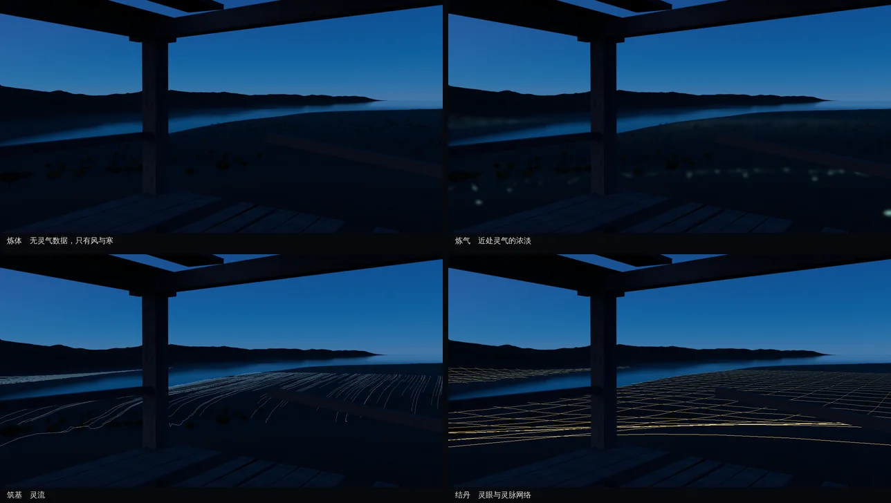

# 06 · 修炼、境界与神识

## 1. 境界顺序：核验结论与修订路线

### 1.1 核验到的事实（原文与行号见 [appendix/canon-verify.md](appendix/canon-verify.md) §1）

| 来源 | 顺序 | 日期与效力 |
|---|---|---|
| Canon 1.0 正文（`system_foundations` 745 行、`system_cultivation_realm` 861–881 行） | 元婴 → **合体 → 化神** → 大乘 | 2026-10-06，LYL 与 Bird 对正文的 SHA-256 双签回执（`canon-receipts.json`） |
| 作者 2026-10-03 的更正 | 元婴 → **化神 → 合体** → 大乘 | 只写在说明文档与验收表中（`docs/FINAL_HUMAN_GATES.md:20` 等），**没有登记进 Canon** |
| 运行代码 `packages/content/src/realm-order.ts` | 化神 → 合体 | 照 10-03 的更正实现，注释写明了这一点 |

上一轮写“运行代码与 Canon 冲突”，只说对了一半：代码不是写错，而是两份文件都处在“已签”状态。

### 1.2 推荐与理由

**推荐以 Canon 为准，即“合体 → 化神”。** 理由有三：

1. 作者 2026-11-26 的裁决 2 明确写着“以正式世界书 Canon 为准”。
2. 双签回执（10-06）晚于更正（10-03）。
3. Canon 正文内部是自洽的：
   - 合体“神识与天地交感，触摸到一丝空间法则”，化神的条件是“合体期大圆满”；
   - 物态链“气 → 液 → 固丹 → 元婴 → 与神魂融合 → 与天地融合（法域）”也是连贯的。

**实施前需要一句话确认**：这一裁决推翻的是作者本人 10-03 的更正，所以请作者确认，并按原流程由 Bird 独立复核。

### 1.3 修订路线（批准后执行）

| 步 | 改动 | 影响 | 测试 |
|---|---|---|---|
| 1 | 新建决定记录 `docs/decisions/2026-11-26-境界顺序.md`（L2），写明 10-03 更正被取代；`FINAL_HUMAN_GATES.md` 等状态文档加勘误链接 | 不动 `canon.registry.json`，因而不触发 P1 规则包重新批准（registry 在 P1 的摘要清单里） | — |
| 2 | `realm-order.ts` 改为 Canon 顺序，注释改为引用决定记录 | `RealmSeal` 天梯、建角建议、`RealmName` 类型自动跟随 | 新增测试：`REALM_ORDER` 必须等于 `canon-runtime.json` 中 `system_cultivation_realm` 各境界小节的顺序，把代码与 Canon 绑定 |
| 3 | 显示别名：Canon 内部混用“金丹期”（799 行）与“结丹期” | 只在显示层建立别名表，不改 Canon | 别名表的单元测试 |
| 4 | 存档、事件、迁移、回放 | **无需改动**：权威存档没有境界字段，只有 `cultivationProgress`；本机旧档里的境界是自由文本 | 回放现有的 golden 事件日志，结果逐字节不变 |
| 5 | 突破规则（新规则版本 `cultivation-v1`，需签署） | 存档 schema v3 → v4：新增 `realm` 与 `realmStage`；迁移规则是 v3 一律视为 `炼体`，进度保留；新增事件类型 `realm.breakthrough.{attempted,succeeded,failed}` | v3 → v4 迁移测试；旧规则版本的存档仍按旧规则回放；突破条件逐条对照 Canon 原文 |

另有一处 Canon 内部无法对齐的地方：妖兽“七级（对应化神期）”（946 行）在两种顺序下都对不上，登记为待作者处理，不由代码裁定。

## 2. 灵力场：九霄的候选“物理”

### 2.1 三类内容分开标注

| 类型 | 例子 |
|---|---|
| **真实科学** | 扩散方程、屏蔽泊松方程、格林函数、莫尔斯理论、图的最小割，这些数学本身是真的 |
| **图形近似** | 用流线、线积分卷积（LIC）、等值线把场画出来 |
| **九霄虚构** | “灵气”是一个满足这些方程的虚构标量场。它不是现实物理，界面与文档都不得称之为物理事实 |

### 2.2 模型

灵气浓度 Φ(x, t) ≥ 0 定义在地表上，满足带衰减与平流的扩散方程：

∂Φ/∂t = ∇·(D ∇Φ) − λ Φ − ∇·(u Φ) + S(x, t)

| 符号 | 含义（虚构） | 取值依据 |
|---|---|---|
| D | 灵气的弥散系数，随地貌变化 | 候选：山地低、平原高 |
| λ | 耗散率：天地吸收灵气的速度 | 候选 |
| u | 携带灵气的流：风 | 灵感来自郭璞《葬书》“气乘风则散，界水则止”。风使灵气散开；水体当作反射边界（∂Φ/∂n = 0），即“界水则止”。这是**典籍启发的设计**，不是物理 |
| S | 源：灵脉节点、天时耦合（灵潮系数，见 04 §5） | Canon：“灵脉”“灵气充裕之地”；灵脉位置是候选 |

**稳态**（∂Φ/∂t = 0，u = 0，D 为常数）是屏蔽泊松方程：

D ∇²Φ − λ Φ = −S

点源的二维格林函数为 G(r) = K₀(r/ℓ) / (2πD)，影响半径 ℓ = √(D/λ)。远处衰减约为 e^{−r/ℓ}/√r。所以 ℓ 有直接的玩法含义：一处灵脉能惠及多远。

**灵流** J = −D∇Φ + uΦ，就是筑基期“看得见的液态流”。

**数值方法**：

- 网格五点差分；离线用逐次超松弛（SOR）求稳态。每个地域预计算一次，复杂度 O(N·k)；序章 220×200 的网格约 1 秒。
- 结果存为纹理：Φ 用 R16F，J 用 RG16F。
- 时变部分（灵潮、天劫）只作为乘性调制，不重新求解。
- 如果需要显式时间推进，稳定条件是 Δt ≤ h²/(4D)；否则改用隐式格式。

**验证**：

- 点源的径向剖面与 K₀ 的误差 < 2%；
- 总量守恒：源 = 耗散 + 边界通量；
- 同一种子下结果逐位相同（定点或固定精度）。

### 2.3 拓扑：灵眼、关隘与灵脉

- 把 Φ 当作地形，它的临界点就是三种结构：极大值是**灵眼**，鞍点是**关隘**，连接极大值与鞍点的分界线是**灵脉**。这就是莫尔斯—斯梅尔复形，属于真实数学。
- **阵法**是建在这张图上的结构：节点是阵眼（Canon：天衍城“九座主岛为阵眼，三千辅岛为节点”）；阵法的运转要求图里存在一个环（候选，对应“周天循环”）；破阵就是找最小割，即切断哪几条边会让环断开。

这让结丹期以后的玩法有了一个真实可解的谜题结构，而不是数值比拼。

## 3. 神识：境界决定所见（核心机制，规则须签）

依据 Canon 的“灵力物态”链，每一境开放一类可观测量。**感知数据由服务端从权威的 Φ 计算后下发**，客户端只负责画；不该看到的数据根本不下发。

| 境界 | Canon 依据 | 可观测量 | 画面（“观”形态） | 玩法价值（候选） |
|---|---|---|---|---|
| 炼体 | “此境不求引气” | 无灵气数据；只有身体的感觉（风、寒、心跳）作为文字 | 不叠加任何灵气层（诚实） | — |
| 炼气 | “引气入体，周天循环” | 半径 r₁（约 30–100 m）内 Φ 的标量值 | 淡淡的灵光雾，浓处亮 | 找到灵气充裕之地修炼 |
| 筑基 | 气压缩为液态灵力 | 半径约 1 km 内的灵流 J | 流线 | 沿灵流找到灵脉源头；判断风向对修炼的影响 |
| 结丹 | 凝练固态金丹 | 灵眼、关隘、灵脉网络 | 晶格般的网络 | 阵法：看懂阵眼与薄弱处 |
| 元婴 | 第二条性命 | 生命的气息：他人、妖兽的位置与修为层次 | 远处的“火”，亮度随修为变化 | 发现隐藏者；判断敌我强弱 |
| 合体 | “引动星辰之力，操控一方天象” | 星象与天时对 Φ 的调制 | 天空中的星官与地面灵气的联动 | 择时施法 |
| 化神 | “法域……言出法随” | 在法域半径内改写 S 与 λ | 以自身为中心的场 | **言落成真**：玩家写下的话在法域内成为局部规则（须签规则） |

上图是在望气台入暮的画面上，用本节的模型实际求解序章区域的 Φ，再投影到相机得到的。它包括：

- 灵脉节点：候选设在望气台丘顶，因为“望气”台本身就暗示此地可以观气；
- 河道两侧的反射边界；
- 落石附近的扰动。

数值只是示意，参数待签。

## 4. 修炼的表现

- **修炼（已有规则）**：延时光，时长与消耗的刻数成正比。对于炼体期，画面不出现灵气，只有体力的消耗与天色的推移。
- **突破（候选）**：按物态链做全屏的“相变”：
  - 筑基是气凝为液，流线变粗、变慢；
  - 结丹是液结为晶，网络亮起；
  - 元婴是晶碎而生，一个光点离体。

  突破前，天空提前若干时辰出现预兆，即天劫的云旋（见 04 §4）。突破的结果先由规则结算，表现随后播放。
- **修为色**：每一境解锁一种矿物色，只用在“观”形态与人物卡上。
