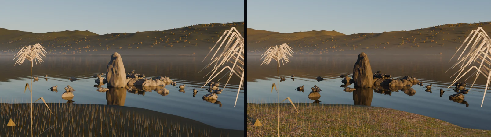

# 09 · 资产生产体系：几何保证事实，AI 只做受控增强

> **2026-11-26 状态补记：** 作者已批准全面实施，本章所写的“需要作者批准、签署、双签、Bird 复核”等事项均已决定，以 [执行台账 §2](../../../execution/JX-VISION-02/README.md) 为准；双作者签收已取消。资产路线是推荐路线，不是封闭清单（[ADR 0009](../../../adr/0009-视觉与渲染技术选型.md)）。

作者裁决 4：不请付费画师；AI 生成、程序化、三维与合法素材都可以进入正式资产。本文给出推荐管线，以及本轮在一台 4 核 CPU 机器上的实测。经两名独立评审指出问题后，管线的主次关系已经调整（修订记录见 [13](13-评审与证据.md)）。

## 1. 结论

**事实与地理由几何保证，质感由真实扫描的材质保证，AI 只做遮罩外的局部增强，并且必须过门禁。**

| 路线 | 本轮实测 | 结论 |
|---|---|---|
| AI 整图重绘（图生图） | 12 帧，SD 1.5，CPU | **不作为主管线**。实测会抹掉事实、编造物体、让地理在不同时刻之间漂移（§3）；12 帧在人工审阅下全部未通过 |
| 三维场景 + 程序化材质 | 13 帧，Cycles | 地理连续，事实正确，光由天文驱动；但材质“像模型” |
| **三维场景 + CC0 扫描材质** | 3 帧（渡口、交谈、远望） | **主管线**。近景的泥、草、岩、朽木有真实质感，事实与地理不受影响（§2） |
| 程序化（天空、水、雾、灵力场、天象） | 上一轮与本轮都有 | 运行时实时生成 |
| AI 局部增强（ControlNet 约束、只在遮罩外、小区域重绘） | 未实测（需要 GPU） | 作为可选增强；必须通过 §4 的门禁 |

## 2. 推荐管线

```
地理数据（与规则共用：地点、路线、锚点）
   │
   ▼
Blender 场景（lab/scene.py）
   ├─ 地形、河流、渡槽、落石、鸦群、船、人物、植被
   ├─ 材质：CC0 扫描（Poly Haven：岩、泥、草、木），按距离混回植被色以避免平铺感
   └─ 每个机位族 × 每个季节 × 每个状态层输出 G-buffer：
        颜色（反照率）、法线、深度、事实遮罩、状态层（如“堵塞 / 通渡”的落石层、“停栖 / 炸起 / 不在”的鸦群层）
   │
   ▼（可选）AI 局部增强：ControlNet（深度、边缘）约束，只在非事实区域、小块重绘
   │
   ▼
门禁（§4）+ 人工艺术审阅
   │
   ▼
打包：AVIF/KTX2 的 G-buffer、manifest（来源、许可、模型、参数、哈希、AIGC 标识）
   │
   ▼
运行时：天空与大气（Hillaire LUT）实时；画板按 G-buffer 用当时的太阳与天光重新打光
        （延迟着色：漫反射 + 天光环境 + 雾的空气透视）；状态层按权威状态切换；DOM 文字
```

**为什么从“按时刻烘焙”改为“G-buffer 重新打光”**（评审 B 指出产能被低估了一个数量级）：

- 按时刻烘焙要乘以时刻 × 季节 × 天气 × 状态，组合爆炸。日出方位在北纬 30° 全年摆动约 ±27°，烘焙的阴影与实时天空必然对不上。
- G-buffer 每个机位族、每个季节外观（秋芦花或冬枯苇）只烘一次；时刻与天气在运行时重新打光；状态是可叠加的层。
- **代价**：运行时的重新打光只能近似二次反弹与软阴影。需要在 X3 实验里与 Cycles 的真值对比，判断是否可接受（11）。



## 3. AI 整图重绘的实测：三类失败

全部参数登记在 [frames/manifest.json](frames/manifest.json)：

- 模型：`stable-diffusion-v1-5/stable-diffusion-v1-5`，CreativeML OpenRAIL-M；
- 提示词、反向提示、强度、种子、耗时、输出哈希。

耗时在 4 核 CPU 上测得，每张 63–295 s。较慢的几张是与 Blender 同时运行时测的。上一版写的“464 s”是一次没有登记的测试运行，已删去。

| 失败类型 | 实例（帧图坐标为 1600×900） | 发现者 |
|---|---|---|
| 抹掉事实 | 交谈、推近两帧，落石与鸦群几乎消失（G1 = 0.23、0.22） | 门禁 G1 |
| 编造物体 | 到渡：现代玻璃建筑（约 1400–1480, 415–450）；渡口：山坡上的郊区别墅；鸦起：海鸥；交谈：落石被画成一个坐着的披袍人影；交谈：渡槽里多出一排木桩；俯瞰：现代农田 | 评审 A、B（人工）；自动 G3 只抓到了海鸥 |
| 地理漂移 | 同一机位四个时刻，河道走向各不相同；渡口与通渡之后只隔 15 分钟，对岸从林地变成草坡 | 评审 A、B（人工） |
| 文化漂移 | 推近帧的房屋先被画成西式农舍；加了反向提示后，整个地点又被画成沙滩茅屋 | 本人 |
| 失控 | 微距帧：低多边形的底图加上小目标，重绘几乎不起作用 | 本人、评审 |

上一版的“合成后相关系数 0.99”是先把渲染贴回去、再在同一块遮罩上测量得到的，是循环论证，不能证明事实被保留。本版已撤回。遮罩修补只是一种修复手段，不是检查。

## 4. 门禁（修订后）

本轮实现并运行了前三项（[lab/gate.py](lab/gate.py)，结果见 [frames/gate.json](frames/gate.json)）：

| 门 | 检查什么 | 方法 | 本轮结果 |
|---|---|---|---|
| G1 事实保持 | **合成前**的 AI 原图在事实遮罩区内与渲染一致 | 亮度相关系数 ≥ 0.95；生产版应改为 SSIM 加色彩直方图距离，并容许 2 像素位移（评审 B） | 5 帧有事实遮罩：4 帧不过（0.22–0.59）；微距帧 0.955 “通过”，但这是**误判**：AI 几乎没改动画面，画面本身就不合格 |
| G2 几何一致 | 全幅边缘结构没有漂移 | 渲染与 AI 原图的 Sobel 边缘图相关系数 ≥ 0.6 | 12 帧全过（0.62–0.93），但人工看到的地理漂移它一处也没抓到。**阈值太松**，生产版至少要到 0.9，并加深度一致性检查 |
| G3 不编造 | 遮罩外没有禁用概念 | 零样本图文模型（CLIP ViT-B/32，MIT）：禁用概念的得分不得高于对照概念 | 6 帧不过（远望四个时刻、鸦起、微距）；6 帧“通过”，其中至少 3 帧是**漏检**：到渡（现代建筑）、俯瞰（现代农场）、交谈（落石被画成坐着的人，“a person sitting”的得分只有 0.001）。对小目标与语义改写几乎无效 |
| G4 跨帧一致 | 同一机位在不同时刻、不同状态之间不漂移 | 深度与边缘的帧间差异 | 未实现 |
| G5 “不存在”断言 | 例如通渡之后，原落石区不得再出现石堆 | 状态层遮罩加分类器 | 未实现 |
| G6 人物必画特征 | 例如岑九的蓑衣、斗笠；“左耳缺一角” | 人物遮罩加人工核对 | 未实现；本轮的岑九（披袍、越南式斗笠）不符合 |
| H 人工审阅 | 地点特征清单、文化、伏笔 | 作者或授权审稿人 | **12 帧全部不通过** |

**结论**：自动门禁是必要的，但不充分，人工审阅不可省。也正因为如此，主管线把事实与地理交给几何，而不是交给 AI。

## 5. 许可与 AIGC 台账

每个资产在 manifest 中登记：

```
{ assetId, kind, producer: 'blender' | 'ai' | 'procedural' | 'third-party-cc0',
  source?: { site: 'polyhaven.com', id, license: 'CC0', url },
  model?: { name, revision, license, sha256 }, prompt?, negative?, seed?, strength?, steps?,
  sourceRender?: { path, sha256 }, gates: { G1..G6, H }, reviewer, reviewedAt,
  aigc: { explicitLabel, implicitXmp }, sha256 }
```

**本轮台账的缺口（评审 B 指出）**：manifest 缺少模型修订号、渲染图哈希；推近帧重跑后的种子与提示词和 `aibatch.sh` 不一致。生产管线必须由脚本一次写全，不能手工补录。

**许可**：

- **可用**：
  - CC0 扫描（Poly Haven，逐个登记 id；本轮使用 `rock_face`、`brown_mud_02`、`aerial_grass_rock`、`forrest_ground_01`、`old_planks_02`，原文件不入库，由脚本按 id 下载）；
  - FLUX.1 schnell（Apache-2.0）；
  - SD 1.5（OpenRAIL-M，带用途限制，需法务确认）；
  - Depth Anything V2 Small（Apache-2.0）。
- **不得使用**：
  - Depth Anything V2 的 Base 与 Large 版（非商用）；
  - 商业用途下的 FLUX.1 dev；
  - 任何受版权保护的作品图像作为输入（包括作者的私人参考图与影视剧照）。

## 6. 产能（修订后）

| 项 | 估算 |
|---|---|
| 一个地点：4 个机位族 × 2 个季节外观 × 状态层的 G-buffer | Cycles CPU 约 3 分钟一帧，约 1–2 小时；GPU 约 10 分钟 |
| 人工搭景与审阅 | 一个地点 1–2 个工作日（X1 的验收标准，待实测） |
| 时刻与天气 | 运行时重新打光，不再乘入烘焙量 |
| AI 局部增强（可选） | GPU；按需使用 |

扩展到五域时按“套件”生产：每个地域一套地形规则、CC0 材质组合、植被、建筑与人物部件。地域的色彩命题（01 §2）作为调色参数。
