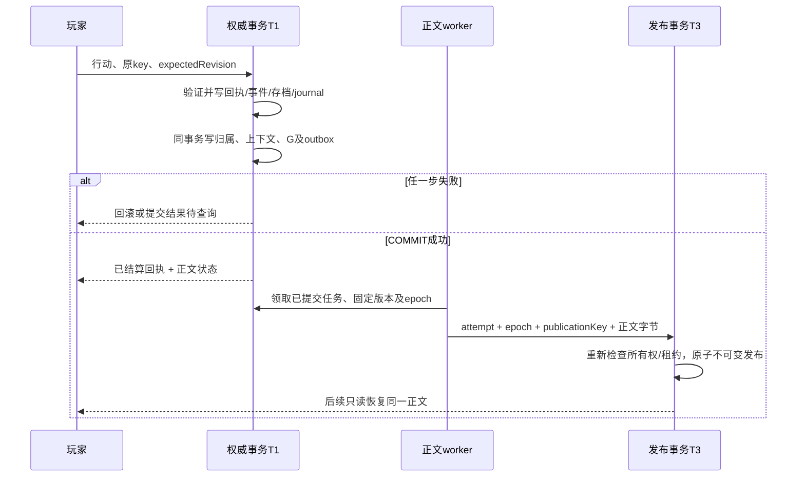

# T1最终事务与叙事分流设计裁决

2026-10-15｜临江仙｜设计推荐，未获实施授权。

## 审核基线与继承证据

固定本地候选 `dbae068d86e5f9cd188d6196e403ce6dd701a1de`，仓库 `C:/Users/11954/Documents/Codex/Nine-cloud-p3-p6-stage1-20261013`。本轮核验前次清单18份源码字节哈希，全部一致，工作区干净；未同步远端，不能称为最新main。沿用 [既有签署影响审查包](../P3-P6-T1-signature-review-20261015/P3-P6正式T1接线补丁签署影响审查包.md)，不重复其完整diff或摘要算法。

水龙吟交接目录可见的适配器最终回执绑定 `cb4fb64bd82ae13e892df35c24cacb6a53bf2536`，明确为只读原型和替身测试；30项契约在三种替身通过，不等于90项生产场景。目录较新材料为10月13日H14修复报告；本轮未发现该目录中的阶段1原始字节门禁/PG工程最终检查点。不能由此断言其他目录不存在新成果。取得其明确交付SHA及差异后必须复核，不触碰对方工作区。

下列源码位置均相对上述固定仓库，行号沿用已验证证据。所有新状态名称是拟议协议，不是现有实现。

## 1. T1：唯一推荐的事务边界

保留 `npc-memory-turn-transaction.ts:271 commitAcceptedTurn` 的账号检查、锁存档、同key回执检查、revision及规则校验、事件、P4/P5授权、存档与journal写入。在该函数431行之后、433行COMMIT之前，使用**同一个PoolClient**登记不可变上下文、正文归属、generation和generate outbox；回调不得自行提交、另开连接、调用模型或建立索引。

推荐接受的产品代价：当本次行动要求托管正文，登记任一步失败，整个尚未提交的行动回滚；玩家得到“未提交/结果待核实”，不能返回成功回执。若COMMIT结果未知，须以原key查询权威回执，不能直接断言已回滚。该代价需要道主明确认可。

已COMMIT之后，无论正文失败、超时、客户端退出，规则事件/revision/journal不能再次结算或撤销。生成器只读T1固定上下文，T3不写游戏状态。已有 `narrative-publication-repository.ts:33 seedAcceptedTurn` 具备同client登记基础，但正式工厂和入口尚未安装。

outbox消费者仅执行已登记任务；不能借后台补登记、触发器或额外轮询修补T1原子性。

## 2. 归属协议：不能用全局函数存在与否分流

推荐新增按 `(owner, save, requestKey, receiptHash)` 绑定的可信持久归属，含协议版本、首请求正文选择、固定renderer/context版本。保存于事务侧metadata，不改写既有不可变回执；具体表/列须在修订补丁审核时固定，当前0022没有完整的此类分流协议。

| 可信记录 | 处理 | 禁止 |
|---|---|---|
| managed-v1，G完整匹配 | 查询/消费该G；pending、running、failed、published分别呈现 | 调用旧writer兜底 |
| suppressed-v1，首请求关闭正文 | 只返回规则回执及not_requested；零G/attempt/source | 后续同key打开正文触发生成 |
| legacy历史，无新协议且已确认属于切换前记录 | 有可验证服务端旧正文则原样读；否则legacy_body_unavailable | 用当前世界状态生成“历史原文” |
| 归属声明managed但G缺失/身份不匹配 | 完整性故障，拒绝生成，告警并保留回执 | 降级为legacy或补造G |
| 无法证明年代/归属 | ownership_unknown，仅返回经验证回执 | 凭创建时间、全局端口或absence猜writer |

新旧区分应以部署前只读盘点并固定的历史回执集合/可靠旧能力记录，以及切换后必写的版本metadata为准。只用时间戳不能处理跨实例时钟和部署中在途事务。旧来源若只有客户端缓存，必须标为本机未验证文本，不能升级成服务端正式source。不要求为旧回执立即生成新publication。

已有 `presentation:151` 以无G返回legacy，适合作为旧基础，但不够证明新协议缺失不是损坏。`narrative-turn-hooks.ts:9` 将null混成失败需修订；`server-turn.ts:141 completed` 待审全局分支须替换。

## 3. requestNarrative=false

推荐保持当前 `server-turn.ts:145` 的可观察行为：行动照常结算，不请求生成，不创建G、attempt、正文或generate outbox；只在T1记录suppressed归属以防后续误路由。

首请求选项持久化后，同key恢复遵循首请求语义。第二次把false改true不得变成叙事重试；返回已有结果并明确选项已固定，或按经审核的协议返回选项冲突。**不得偷偷扩展既有行动fingerprint算法。** 两种响应选择需在修订接口中选定；推荐返回原结果和已固定的正文选择。

“所有accepted都登记正文任务，包括false”的替代方案属于产品变化，需另批，本轮不推荐。旧接口可能允许同key后来请求正文，新托管语义将收紧此行为，也必须纳入批准事项，不能声称完全等价。

## 4. 取消、超时与恢复

| 情形 | 推荐语义 | 权威判据 |
|---|---|---|
| 提交前收到取消且事务尚未COMMIT | 在安全检查点回滚全部写入 | DB无本次提交；取消与COMMIT竞态不能仅凭HTTP判断 |
| 提交后取消/客户端离开 | 取消等待及展示，不取消已结算行动；已登记任务可继续 | receipt/G持久存在 |
| 20秒等候到期 | accepted + pending/running，给只读恢复标识；不写failed | 查询G/attempt/publication |
| 网络丢失、刷新、换设备 | 验证身份后按原requestKey/receipt恢复；未知则查询，不换key | 对应账号、存档、指纹、revision |
| 活租约仍在运行 | 返回running，不领取第二任务 | 服务器时钟和lease |
| worker崩溃、租约过期 | 经批准的有界恢复，提升epoch、旧attempt失效 | 同G、固定renderer/context |
| 显式failed | 只读显示失败，不因行动重复提交重新领取 | 独立叙事重试仍待审 |

当前服务默认超时20秒，但 `index.ts:45` 实例传入120秒；不能声称当前实际入口已统一20秒。推荐把HTTP正文等待预算与worker执行/租约预算分离，20秒只限制等待。取消接线与此预算属于待批行为。

## 5. T3及writer互斥

复用0022的generation/publication唯一键、默认版本唯一索引和不可变约束。T3在一事务内写source、publication、segments、来源链接、index outbox及完成状态，失败全部回滚；规则T1不回滚。

依据 `narrative-publication-repository.ts:67 claim / :90 publish`：发布必须重新验证账号/存档活跃、G/context/receipt身份、renderer版本、当前epoch、attempt及租约有效性。publicationKey固定initial-v1，重放同attempt同字节只返回同P；异字节、异身份、过期epoch拒绝，不竞争默认发布。不允许调用者只拿publicationKey发布。

多实例只允许一个有效租约；进程失联后旧worker可能仍在计算，因此**不能保证物理生成只执行一次**。可证明的目标是无第二个同时有效writer、过期结果不能发布、唯一有效默认正文。不得对可能付费的生成声称exactly-once成本。

上线前所有实例须支持归属协议，排空旧writer和旧在途请求，再配对开启T1及托管读取。无法证明旧版本退出则不启用；全局开关只能控制新流量准入，不能充当每条回执归属。旧writer也须遵守可信归属或彻底退出写路径。新writer失败禁止退回旧writer。

## 6. 关闭、删除与记忆边界

定义与关闭操作的锁定顺序：账号→存档→G/attempt。T1和T3须与关闭更新争用相容的行锁；先关闭则拒绝，先提交则保留已提交事实，但关闭后不得领取/发布/读取。现有T1无guard时FOR KEY SHARE不能阻止closed_at更新，须复核并修订；T3现有FOR SHARE基础可复用。物理删除按既有生命周期清理依赖；迟到worker不可重建删除数据。恢复账号不自动重跑failed；过期未完成任务的恢复须按批准生命周期，不擅改关闭政策。

P4显式记忆、P5叙事遗忘保持不同policySurface。第一阶段仅player-only正文；正文可读不授予NPC知情，固定提示不代表额外世界事实。原P4/P5授权/journal必须与未接线基线逐字段等价；T1失败则双方一起回滚。现有worker传npcMemories=[]，不能据此宣称新链已保留旧叙事NPC检索效果或完成P6接入。

## 裁决

上述为最终推荐设计。现有pending补丁不满足分流、false、取消、failed重领及部署互斥边界，**仍需修改后重新审核**。本文件不是代码接线、重签或启用权限。
