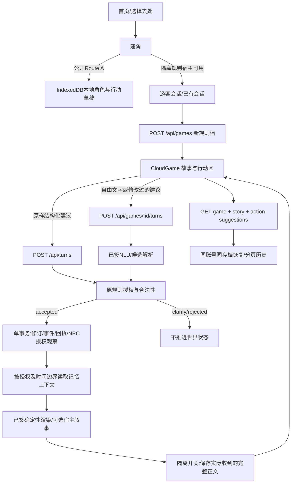

# 本轮架构与功能审计

证据为本分支真实源码、`tests/e2e/story-first-golden.cjs` 和本轮测试输出，不能用模块名或截图示意代替主流程。生产未经本轮改动。

## 调用链

## 状态矩阵

状态指隔离候选主流程；公开限制单列。`IMPLEMENTED_CONNECTED`不自动代表真人理解或完整产品READY。

|功能|隔离状态|本轮证据/边界|公开Route A|
|---|---|---|---|
|首页/世界选择|IMPLEMENTED_CONNECTED|foundation及正式E2E，本地资料入口|可体验|
|本地建角/IndexedDB恢复|IMPLEMENTED_CONNECTED|foundation/idb/game-shell；并非服务端规则角色映射|可体验|
|建角到规则存档|PARTIAL|真实UI创建游客档；表单身份修为外貌未映射规则，页面明确说明|BLOCKED_BY_POLICY|
|自由文字到动作|PARTIAL|已签语法支持移动/观察/指定话题交谈/特定物品及战斗；非通用自然语言|BLOCKED_BY_POLICY|
|建议可编辑|IMPLEMENTED_CONNECTED|点选填入不执行；编辑后清除结构化动作，交回已签解析；黄金测试断言|BLOCKED_BY_POLICY|
|规则验证/回合事务|IMPLEMENTED_CONNECTED|PG43及真实十回合，拒绝和澄清不推进状态|BLOCKED_BY_POLICY|
|拾取/领奖/返回主地点|IMPLEMENTED_CONNECTED|新增入口调用既有ActionIntent；没有新增规则/签署|BLOCKED_BY_POLICY|
|当前剧情反馈|PARTIAL|已批正文和规则提示真实返回；移动等反馈简短，未获批续篇不能补写|BLOCKED_BY_POLICY|
|完整已收到故事恢复|IMPLEMENTED_CONNECTED|新story archive、逐段全文相等断言；旧正文不回填；仅本轮隔离开关|BLOCKED_BY_POLICY|
|短期/长期数据及授权观察|PARTIAL|事件、观察、策略/召回存在；默认分类仍可unclassified，不等于自动巩固|BLOCKED_BY_POLICY|
|记忆影响默认叙事|IMPLEMENTED_DISCONNECTED|上下文已构造；确定性fallback不读取历史。需作者新审查|BLOCKED_BY_POLICY|
|后续剧情引用黄金段经历|BLOCKED_BY_POLICY|缺少默认叙事变体及对应新签署；不编造NPC反应|BLOCKED_BY_POLICY|
|NPC私密/未来信息隔离|IMPLEMENTED_CONNECTED|既有事务/召回测试与版本合同保留；不放宽安全规则|BLOCKED_BY_POLICY|
|存档间隔离/重复提交恢复|IMPLEMENTED_CONNECTED|真实PG存档隔离、他账号拒绝、不可变正文/幂等重放；UI恢复故障测试|BLOCKED_BY_POLICY|
|完整人物/场景/行囊体验|PARTIAL|当前地点与已批物品名可显示；人物身份与完整场景描述仍不足|本地角色资料|
|五人无提示理解|UNKNOWN|已有人选，问卷与记录表已交；原始记录未收齐，HUMAN_REQUIRED|同样需真人|
|手机真实软键盘|UNKNOWN|376/390自动化不能代替实机；手机暂不可用|未验证|

## 行动边界

- 已批准且有入口：原样结构化拾取/领奖、现有文本移动/交谈/观察等；结果仍由服务端规则裁决。
- 同义表述：仅现有NLU模板覆盖的安全映射，不擅自扩大签署语法。
- 需澄清：缺对象或无法映射；显示具体候选（如有）和当前动作菜单；不让NPC假装说出未批对白。
- 禁止：原规则rejected消息与状态不变；不把无法执行改写为成功剧情。
- 未实现：无限自然语言理解、默认长期记忆驱动续篇、建角资料的服务器能力映射。见作者审查申请。

正文存储是展示归档，不回写权威事件、规则、记忆分类，不保存玩家原始自由输入；已确认进度与正文保存失败的提示分开。生产启用开关直接拒绝启动；新迁移只在本轮独立数据库执行。
