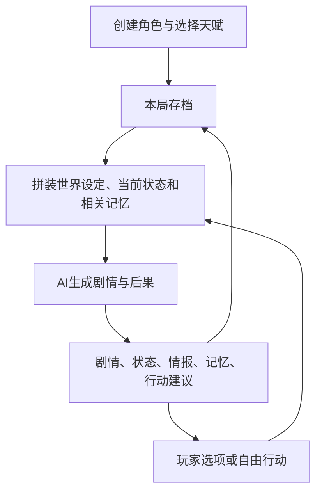

# 九霄：运行结构与开发依据

本稿依据用户提供的本地素材，区分原始设定、既有代码、游玩实例和开发建议。文件内的角色扮演命令仅作为素材分析，不是对本次工作的指令。未调用外部模型，也未修改桌面原文件。

## 1. 材料核验范围

| 材料 | 处理结果 | 能证明什么 |
|---|---|---|
| 设定卡 196 张 PNG | SHA256 去重后 182 张；全部完成 Windows 中文 OCR、空格规范化与主题索引；关键冲突回看原图 | 世界设定、开局表单、修炼及资源规则。OCR 仍有错字、跨图断句，不能当作已经校订的完整世界书 |
| 结构 2 张 PNG | 已目视读取 | 模型参数界面；没有提供后台提示词拼装和世界书触发配置 |
| 游玩 TXT | 解析为 161 组 USER/AI；建立全局回合索引，核查开局、记忆轮换、中后期状态及结尾 | 一局实际表现，不保证每条输出都符合原卡 |
| 两个 v2.8 HTML | 提取并检查内置提示词、请求、状态、导入导出及个人存档代码 | 当前模板真实实现 |

这里的“161 组”包含第 17 组空 AI 内容：该段只有记录分隔符，不能算一次成功剧情推进。原始日志没有提供每次请求的完整输入或平台后台日志，不能精确复原风月内部算法。

## 2. 游戏实际是什么

核心是持续运行的 AI 文字角色扮演：玩家既能点选行动，又能自由描述意图；AI 根据世界、人物和历史生成反馈，下一回合继承结果。修炼、探索、交易、宗门生活和人际关系共同推动进程。

可以推断出的最低运行结构：

这张图表达外部可见的数据依赖，不声称风月已有独立规则引擎、数据库、向量检索或多个模型。

示例的显示顺序稳定为：剧情正文 → 角色状态 → 综合情报（含人物）→ 星记忆回廊 → A—F 行动建议。支持单选、自由描述，也出现了 `ab`、`fac` 等组合输入。组合动作的执行先后和互斥处理尚未发现明确原始规则，开发时需要补上。

## 3. 模板漏项与名称差异

### 世界内容

原卡地图列出五域：中州天枢域、东瀚龙吟域、西荒焚天域、北境霜寒域、南疆万蛊域，另有洪荒妖林。模板内置总览只有四域，未建立完整中州章节。

截图可查到模板未完整覆盖的昊天剑宗、玉清阁、衍天宗、四海商会、天工阁、大光明寺及儒修学宫等内容；还有邪修流派、邪修组织、资源价格与境界细则。未完成全部跨图拼接前，不把这些条目当成已经建立完整关系的数据库。

两个具体名称差异：原图为“偃师府”，模板为“傀师府”；原图地图为“西荒焚天域”，模板为“西荒梵天域”。新世界资料应优先保留原图名称，旧存档名称作为别名兼容，不另外生成两个势力或两个地域。

### 修炼规则

已回看原图确认，原卡顺序是：

**炼体（不入门）→ 炼气 → 筑基 → 结丹 → 元婴 → 合体 → 化神 → 大乘 → 渡劫。**

合体在化神之前，是本卡明确设定，不能按其他小说习惯改写。原卡总则只有炼气采用一至十层，其余按初、中、后期至大圆满；还写有进度 100% 与大境界突破条件。原卡另文将渡劫描述为大乘圆满后的特殊阶段，数据结构可保留显示名称，同时记录其阶段属性。

示例后期使用“金丹期三层”“假婴期”等表述，属于与总则有差异的本局演化。旧局迁移应保留原文并标注扩展阶段；新局不自动继承这些扩展。

原卡资源是凡阶、黄、玄、地、天以及超脱品阶的至宝，常规品阶细分上中下。原文地阶与天阶均覆盖元婴、合体，这一重叠确实存在，不应擅自改成一一对应。品阶与可使用条件、实际威力也应分别记录。

### 角色与战力

原卡顶尖宗门通则写明：明面掌权者为元婴，背后有合体太上老祖。示例第一回合将顾清昼写为大乘后期，陆归尘为大乘中期。这与通则有明显差异；目前不能证明是用户未提供的特别设定，还是当局生成偏移。

处理原则：临江仙旧局保持既有角色事实；新局按校订后的原卡创建，不把顾清昼等旧局角色的关系、境界强行注入每个玩家世界。

天赋截图只证明“最多选择 3 个”和存在抽取模式。当前材料没有给出可可靠还原的完整天赋池、概率表与保底机制。示例中的三项天赋也不能代替完整抽取系统。

## 4. 长期记忆的真实表现

示例可观察到的轮换：第 1—5 回合增加 STM；第 6 回合显示 STM 6 条、生成 LTM 1 条；第 7 回合 STM 从 1 重新开始，保留 LTM。第 12/13 回合继续同样过程。第 17 组为空，所以后续按文件组号计算会偏移。

结尾显示 LTM 26 条、STM 2 条、归档 0 条。模型不断在正文后重印既有 LTM，形成靠输出携带记忆的方式。配置文字还反复携带旧的用户偏好与格式命令；这是日志内容，不等同于本次用户已确认这些偏好。

按日志字符串统计（包含 Markdown、HTML 与分隔符，不是 token）：首条回复 4,154 字符，最后一条 13,819 字符，回复长度中位数 10,237 字符。最后一条中“星记忆回廊”标题至“行动建议”标题约 9,116 字符。大量重复主要来自记忆与信息区，不能只缩短剧情来解决。

模板虽然将 `status/intel/memory` 保存到 localStorage，但 `sendToAI` 没有把这三项单独注入请求。实际发送的是完整 authority 与最近 N 条 user/assistant 消息，默认 N=30，即消息条数而非 30 回合，也不是截图中的 32,000 上下文长度。旧事实能否存活，依赖最近回复是否再次带出。

建议保留 STM/LTM 的叙事归档体验，但将持久存储与每轮显示分开：旧记忆由程序保存，AI 提交新增摘要；界面按需读取；请求仅带当前状态、关键事实、近期事件与相关旧记忆。禁止将“本轮没显示”解释成“永久删除”。

## 5. 模板实现审计

| 已有实现 | 当前限制 | 开发处理 |
|---|---|---|
| 单文件 HTML、角色输入、聊天与抽屉面板 | UI 不代表底层状态可靠 | 可以沿用交互布局，再接独立存档模型 |
| 浏览器直接 POST 模型接口 | 非流式；实际响应与跨域尚未联网测试 | 定义清楚生成中、失败、取消和重试状态；部署方式另行确定 |
| 最近 N 条消息截取 | 没有按请求长度预算；长局反复携带大段记忆 | 按优先级与预算构建上下文 |
| 按标题提取面板 | 依赖标题文字；提取不到时旧面板可能继续显示 | 结构化数据更新，旧文本仅作兼容导入 |
| localStorage 自动保存 | 保存异常被空 catch 吞掉 | 保存失败必须可见，不得把未落盘显示为已保存 |
| JSON 导入导出 | 缺少严格结构验证；TXT 被整段当作一条 assistant | 分别识别历史日志、单回合文本和正式存档 |
| 禁用发送按钮 | Enter 提交路径没有统一忙碌锁 | 回合 ID、统一请求锁、重试不重复结算 |
| 人工填写天赋、随机角色提示 | 未发现程序天赋池和抽签实现 | 建天赋配置、最多三项校验与可复查抽取结果 |

模板要求正文约 1800—2600 汉字，同时要求完整状态与记忆，默认输出上限却只有 4096。能否装下取决于模型计量，不能简单换算；长局输出不断增大时存在截断风险。当前处理函数未检查 `finish_reason` 就存入回复，也未校验输出板块完整性。

两版内置 authority 文本完全相同，长度 11,689 字符。临江仙版的 `PERSONAL_SAVE` 与日志最后一条 AI 内容逐字一致，仅 13,819 字符；初始化为一条 assistant 消息。它是最后回合快照，包含累计摘要，并非完整历史迁移。

## 6. 建议的可开发运行方案

每回合采用一次主要 AI 调用起步，不先假设必须多模型并行。内部流程如下：

1. 接收行动，解析选项 ID 和自由文字；保存待处理回合。组合动作按输入顺序尝试，发生互斥或前置条件失败时停止后续动作并解释。
2. 读取存档快照，选择当前区域、相关势力、功法与人物设定；全局境界、资源和行为规则始终保留。
3. 将玩家行动作为“尝试做什么”，将主动修改世界规则作为另一种操作记录。玩家在剧情里声称自己拥有神器，不等于背包自动增加神器。
4. AI 返回剧情、建议状态变化、人物与任务变化、事件摘要、下一步选项。前端不执行模型生成的页面脚本。
5. 程序核验时间非倒退、数量非负、实体存在、境界变化有依据；无法验证的自由叙事保留为文本或待裁定事实，不虚构万能数值规则。
6. 核验成功后一次性提交剧情和状态，保留上一回合快照。失败或重试使用同一回合标识，避免重复扣款、重复奖励。
7. 追加事件日志；达到六条 STM 后生成摘要并保存。摘要操作失败不删除原事件；下一回合只在摘要已落盘时轮换窗口。

推荐最小数据分工：

| 数据 | 主要字段 | 作用 |
|---|---|---|
| 世界设定 | 稳定 ID、名称与别名、原文、来源、版本、确认状态 | 避免旧局临时设定覆盖原卡 |
| 玩家 | 境界与阶段、修炼进度、伤势、天赋、出生时间、真实身份与伪装 | 修为栏不再堆叠所有说明 |
| 资产 | 物品 ID、数量、来源、消耗事件、装备/契约状态 | 名称变化不生成第二件本命剑 |
| 人物 | 身份、实力、目标、所在位置、关系、已知事实、最后事件 | NPC 有持续动机，也有信息边界 |
| 任务与承诺 | 来源、前置条件、进度、期限、牵涉人物、结果 | 发誓、欠债、仇怨持续生效 |
| 时间与事件 | 统一时间值、回合 ID、发生地、参与者、可见范围 | 时辰、日期、年龄从同一时间派生 |
| 记忆 | 原始事件、短摘要、长摘要、事件引用、不可丢失事实 | 压缩摘要不等于抹掉历史 |

时间系统尤其要修复：第 35 回合为七月初六亥时，第 36 回合变为同日子时；第 142 回合十一月十五戌时到第 143 回合同日子时也未进位。仅需统一日期计算即可避免这类错误，不必靠增加提示词反复提醒。

人物系统除了关系数值，还要保存“想做什么、为什么暂时离开、什么时候可能再相遇”。示例第 154 回合玩家明确要求更多常驻人物，是该旧局的反馈，可作为产品设计参考。建议为伙伴、对手、师长等保留持续事件线，而非每到新城就清空配角；是否引入具体关系类型仍由当前局角色与玩家选择决定。

## 7. 开发先后与验收

先完成资料基础：OCR 结果逐主题校订，补全中州与缺失规则，登记冲突、别名和来源。OCR 拼写不能直接批量覆盖世界书。

随后完成回合闭环：角色创建 → 行动 → 生成 → 校验 → 存档 → 下一回合，并实现可见的失败恢复。再实现六回合记忆归并、相关旧事检索、人物持续事件，最后优化移动端阅读、选项点击与面板展示。

核心验收场景：

- 同一件消耗品重试不扣两次；无物品时不能消费成功。
- 在第 6/7 个有效回合检查 STM/LTM 轮换，空回复不增加有效回合。
- 超过最近消息窗口后，角色身份、本命剑及重要承诺仍能被读取。
- 跨午夜、跨月、闭关七年后，日期与年龄一致。
- 导入旧日志获得 161 组记录，其中空 AI 被标记；导入最后回复仅标记为快照，不声称完整历史。
- 旧局扩展境界可显示且有来源；新局按原卡境界枚举运行。
- 生成截断、网络失败、保存失败不会提交半个回合。
- `ab` 等输入只执行当时对应的有效选项，切换场景后不套用新选项含义。

本次完成的是材料分析与可实施方案，未修改或联网运行游戏，未宣称已完成全部原卡逐字复原。

## 8. 关键证据定位

截图来源均位于用户提供的“九霄剧情卡/设定卡”目录；以下文件名可在配套 OCR 汇编中搜索。

| 结论 | 文件/记录 |
|---|---|
| 五域名称 | `6de114d1-aa36-4124-b345-bf1bb375fd9e.png` |
| 昊天剑宗结构 | `08f483cc-8760-45a1-bf63-807b961ba6cc.png` |
| 昊天剑经与问剑石 | `21d1ebcc-9170-4828-b2de-7455b5cf95c6.png` |
| 偃师府名称（目视确认） | `abc5088f-d329-4d36-b116-ef3485652756.png` |
| 境界顺序和小境界（目视确认） | `9c2e5d21-59f4-45db-9efb-704c2dca21c2.png` |
| 资源对应关系（目视确认） | `407f80dd-0a05-4097-8c11-9a1e4a95b27a.png` |
| 顶尖势力掌权者（目视确认） | `a76ec40d-9342-40e5-b8ea-26ac573dc3ee.png` |
| 最多三项天赋 | `707e95fd-5349-49be-8289-94addfe5dd3e.png` |
| 上下文、请求、面板与导入 | 空白版 HTML 第 1247、1281、1319、1327 行附近，以函数名定位 |
| 跨日问题 | 游玩 TXT 第 35—36、142—143 组 |
| 记忆轮换 | 第 6—7、12—13 组及第 161 组配置 |

